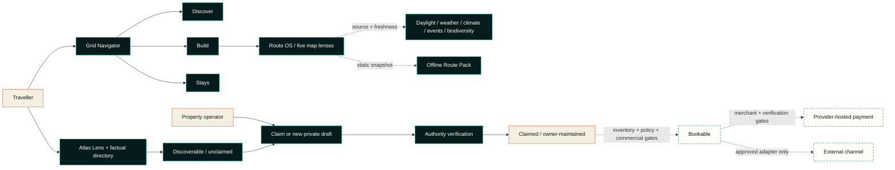

# TPTS Grid

> **Namibia moves through here.**  
> Book the road, not just the room.

TPTS Grid is a Namibia-first travel network for spatial discovery, traveller-owned route planning and direct property onboarding. Its current public release makes Namibia easier to explore without pretending that a sourced map record is a partner, that a route line is navigation, or that an integration pathway is live inventory.

This is the public product case study. The production source, credentials, commercial agreements, private host submissions and payment implementation are not published here.

The canonical customer production surface is [tpts-grid.pages.dev](https://tpts-grid.pages.dev), hosted on Cloudflare Pages.

The **Namibian Meridian** visual release turns that product into a journey through the country rather than a stack of interchangeable software panels. A real road to Spitzkoppe opens the experience; Dune 45, the Skeleton Coast, Etosha and the Okavango move through a four-part editorial sequence; Spitzkoppe closes the story. Each photograph is location-specific, source-linked and used only as destination atmosphere—not as evidence that a property is listed, partnered or bookable.

The **TPTS Route OS** production release was deployed and externally verified on 18 October 2026. It keeps one map and adds five switchable intelligence lenses, a source-backed signal deck and a bounded offline export. `Live` still has a narrow meaning: deployed provider-backed behaviour with a tested fallback—not market availability, safety authority or commercial approval.

## Current product snapshot

The 18 October 2026 product is organised around **one shared traveller map**, a cinematic Namibia narrative and two deliberately different evidence and host tools:

- **Namibian Meridian** gives the interface a place-specific cinematic spine: six real Namibia photographs, a four-movement landscape sequence, geography-led section atmospheres, an editorial serif voice and a restrained route line that carries the eye through the page. Responsive WebP derivatives, visible credits and reduced-motion behaviour keep the treatment deliberate rather than decorative.
- **The Grid Navigator** keeps discovery, route composition and factual stay inspection in one geographic workspace. Its three task lenses—**Discover**, **Build** and **Stays**—change the controls and overlay, not the traveller's place in Namibia.
- **Discover** searches 21 real Namibian destination anchors. **Build** lets a traveller add up to 12 stops, remove or reorder them, name the trip, set its length, keep it in local browser storage and share it deliberately. **Stays** filters and selects factual property points without inventing price, availability or partner status.
- **TPTS Road Intelligence** adds live MET Norway point forecasts and production-connected openrouteservice road geometry, distance and estimated drive time to the traveller's chosen stops. The bounded server adapter preserves a direct-line fallback and visibly withholds road kilometres and drive time whenever routing is unavailable.
- **TPTS Route OS** nests five focused views inside Build—**Route Truth**, **Daylight Corridor**, **Weather Along Route**, **Route Essentials** and **Living Namibia**. These are lenses over the same MapLibre instance, not five maps and not five competing journeys.
- Live intelligence includes a MET Norway Sunrise shared-solar window, NASA POWER climate memory, bounded NASA EONET event awareness and an aggregate, count-only GBIF biodiversity signal. No GBIF record, species name, coordinate, media item or sensitive-location detail is exposed by this layer. Every section exposes its provider state, timestamp or evidence period, attribution, limitation and empty/degraded state.
- **Route Essentials** deliberately draws no unverified objects while a versioned, TPTS-hosted OpenStreetMap extract is still gated. The browser does not put a public Overpass instance in the traveller request path.
- A bounded **Offline Route Pack** exports the chosen stops, latest available route truth, weather, daylight, source names, timestamps and limitations as a static traveller-controlled file. It is not an offline basemap, live navigation, a booking document store or a self-updating alert service.
- **The Atlas Lens** replaces a second directory map with a quieter regional evidence view: **28 factual public property records**, **27 exact, individually attributed OpenStreetMap points** and the distribution of those records across the represented regions.
- **The owner precision map** is not another exploration surface. It stays closed until an operator explicitly opens it to place or review one public-facing point, with manual coordinates retained as a fallback.
- **Field, Atlas and Signal** remain visual map appearances over the same attributed OpenFreeMap/OpenStreetMap context. A style change never alters route order, record state, inventory or trust.

The public product also includes 21 geographic destination anchors. Destination anchors and property records are intentionally different datasets: one supports route context; the other provides a minimal, correctable path for a real property to be found and claimed.

The [previous standalone Route Studio capture](assets/tpts-grid-route-studio-live-2026-10-16.jpg) remains in this repository as release history. The current product folds that capability into the Grid Navigator; the image is not presented as the current information architecture or as evidence of live room inventory, an OTA connection or payment activation.

## Product truth at a glance

| Surface | Current posture | What is deliberately not claimed |
| --- | --- | --- |
| Namibian Meridian story | Six source-linked, location-specific Namibia photographs; four regional movements; responsive derivatives; in-product credit register | That destination atmosphere depicts a listed property, room, partner, review, price or live inventory |
| Grid Navigator | One traveller map with Discover, Build and Stays task lenses; live stop weather; provider-routed road geometry when connected | Turn-by-turn navigation, proof of road access or safety, availability or a reservation |
| Route OS | Live five-lens Build map plus daylight, climate, event and aggregate biodiversity context; providers degrade independently | Comprehensive coverage, emergency authority, wildlife predictions or a road-safety verdict |
| Offline Route Pack | Live static export of the traveller's route and the latest available, dated planning context | Offline tiles, continuous updates, navigation, emergency coverage or proof that a booking exists |
| Map appearance | Field, Atlas and Signal styles; accessible status and text fallbacks | That a style, marker or map point is a partner or a bookable room |
| Atlas Lens and property directory | Regional evidence view plus 28 independently checked factual records; 27 exact OSM points | A duplicate exploration map; copied OTA descriptions, photos, ratings, reviews, prices or availability |
| Property records | Official link, locality, source provenance, claim and correction paths | Operator control until authority has been verified |
| Owner onboarding | A three-step private submission and verification queue | Automatic publication, verification or bookability |
| Owner account access | Gated pending a TPTS-owned identity boundary | That owner authentication, an account workspace, operator controls, publication or inventory activation are live |
| Integration launchpad | Live 29-path readiness catalogue; 7 public-data paths meet the product's Live evidence rule | Credentials, approval, agreements, inventory or commercial access for any non-live path |
| Payments | A guarded server-side architecture and readiness boundary | Live payment creation or automatic paid-state confirmation |

## From discoverable to claimed to bookable

Grid exposes a simple public promise while keeping the operational gates explicit.

| Public truth state | Evidence required | Current meaning |
| --- | --- | --- |
| **Discoverable** | Independently checked name, locality, official website and source provenance | A factual directory shell. It is unclaimed, not a TPTS partnership and not bookable. All 28 current public records are here. |
| **Claimed** | Verified authority to represent the property plus owner-licensed content | The operator can maintain its truth. Claiming does not create inventory, a rate or a booking channel. |
| **Bookable** | Claimed property, activated and fresh inventory, policies, commercial approval and an approved payment/reconciliation path | A separately gated future state. No current public directory record is presented as bookable. |

Owners can start a claim from a property card or factual record page. Every record also offers a direct **correct / remove** route that does not require an account. A correction, ownership claim or removal request is a governance action, not a commercial conversion.

## The Grid Navigator and Route OS

The Grid Navigator gives the map one clear job at a time without forcing the traveller to restart or jump between competing geographic surfaces.

- **Discover** reads the country through searchable destination anchors, local context and direct actions to add a place or inspect nearby factual stays;
- **Build** turns the route into the primary travel object without locking the traveller into an opaque generated itinerary;
- **Stays** synchronises the map with the factual property ledger so selecting a marker or record updates the same focused context;
- story-led route prompts, directory actions and the command palette deep-link into the relevant lens rather than opening another map.

Within Build, travellers can:

- search, add, remove and reorder real destination anchors;
- change the trip name and number of nights;
- see an optional, explainable suggestion that can be accepted or undone;
- store the draft locally on the device and share only on request;
- retain a text-first editing surface when the basemap is degraded;
- see live point weather across selected stops;
- receive provider-routed road geometry, distance and estimated drive time only from a successful server-side routing response;
- fall back to clearly labelled direct-line context while withholding road kilometres and drive time when routing is not connected.

The Road Intelligence deck makes provider failure visible instead of letting it collapse the itinerary. Weather, route editing and the base map degrade independently. Even a routed result remains planning guidance—not turn-by-turn navigation, proof of access or a road-safety statement.

Inside Build, Route OS gives that same map five subordinate intelligence lenses:

| Lens | Live behaviour | Truth boundary |
| --- | --- | --- |
| **Route Truth** | Shows traveller-chosen order and production-connected openrouteservice road geometry and estimates after a successful provider response | A provider failure returns clearly labelled direct-line context and withholds road kilometres and drive time; routed output remains planning guidance, not navigation or a safety verdict |
| **Daylight Corridor** | Uses MET Norway Sunrise 3.0 to show sunrise, sunset and the solar-window overlap across chosen stops | Astronomical context is not visibility, road condition, personal safety or a departure recommendation |
| **Weather Along Route** | Places the existing, time-stamped MET Norway point forecasts on the chosen line | A point forecast changes and is not corridor-wide road or access evidence |
| **Route Essentials** | Provides a governed home for fuel, water, clinics, repair and similar mapped services | It remains intentionally empty until a versioned Namibia extract, ODbL review and freshness display are ready |
| **Living Namibia** | Summarises dated EONET event awareness and a five-year aggregate GBIF occurrence count without exposing records, taxa, coordinates or media | EONET is not an emergency or closure feed; the GBIF count is not a sighting forecast |

The companion signal deck adds **Climate Memory** from NASA POWER. It samples a bounded set of route stops and labels historical monthly climatology as regional evidence, never as today's weather. Each intelligence section can fail or return no match without disabling route editing, the base map or the other sections.

The live Offline Route Pack is a portable snapshot of the route and whatever verified context was available at export time. Its own copy says that it does not update itself. A future native offline-map capability remains a separate evaluated programme with licensing, expiry, storage and deletion gates.

The cinematic opening composer can suggest a route from a brief such as coast, desert or wildlife, then hands that suggestion into Build. The hero uses real Namibia imagery and an animated route thread instead of running a competing live map behind the primary task. Suggestions remain editable and carry no inventory, price, road-safety or availability authority.

The Atlas Lens is intentionally not a fourth Navigator mode. It is a factual regional ledger that shows record concentration and gaps, then hands a selected set back to Stays when geography is useful.

## Property discovery and owner onboarding

The directory is intentionally factual and sparse. Public seed records use only independently checked names, localities, regions, official websites and sourced coordinates. They do not reproduce third-party photography, logos, descriptions, ratings, reviews, room types, prices or availability.

The owner path has three progressive steps:

1. identify the property and set a public-facing map point, with manual coordinates as a fallback; the precision map mounts only after an explicit operator action;
2. provide operating context such as property type, room/unit count, website and traveller-relevant notes;
3. provide private contact details, attest authority and submit to the TPTS verification queue.

Contact details and verification evidence remain private. Marketing consent is separate and optional. A submitted draft enters `verification_required`; it is not silently published and cannot become bookable without later inventory activation.

Owner authentication and the account workspace are not live on the canonical customer production surface. Both remain gated until TPTS operates an identity boundary that can authenticate an owner and scope records without exposing operator credentials. The public claim, correction/removal and private submission paths remain separate from future authenticated account access.

## Safe integration launchpad

Grid exposes an integration research surface, not an integration trophy case. The production launchpad was reviewed on **18 October 2026** and classifies 29 paths without asserting credentials or commercial access beyond the seven provider-backed public-data paths that passed production verification.

| Stage | Paths | Meaning |
| --- | --- | --- |
| **Owned** | TPTS Direct | The canonical discovery, claim and future native-inventory direction belongs to TPTS. |
| **Live** | OpenStreetMap foundation, MET Norway Weather, MET Norway Sunrise 3.0, NASA POWER, GBIF, NASA EONET, openrouteservice | Provider-backed context is deployed with attribution, explicit limits and independently degradable fallbacks. |
| **Ready** | OSM Route Essentials, Wikidata + Wikimedia Commons | A documented technical path exists, but the activation or governance evidence is still incomplete. |
| **Apply** | WhatsApp Cloud API, Booking.com Demand, Expedia Rapid, Hostelworld, ResRequest ResConnect, NightsBridge | A business setup, application, affiliate, NDA/audit or commercial relationship is required. TPTS approval is not claimed. |
| **Evaluate** | NASA FIRMS, Workers AI + Vectorize, Offline Grid Pack, Frankfurter FX, Cloudflare Turnstile, Hotelbeds / HBX, Google Hotel Center, Travelgate Hotel-X, Channex, Wetu | Technical access may exist, but safety, privacy, licensing, commercial or inventory-maturity gates remain. |
| **Restricted** | Booking.com Connectivity, Amadeus Hotels, Airbnb | Intake or access constraints make these unsuitable as launch dependencies. |

The interface links each card to an official programme page and states the next legitimate action. It does not scrape inventory, invent partner status or place an external channel inside the canonical TPTS record. See the dated [public verification register](docs/verification-register.md).

## Payment is a hard boundary

TPTS Flow models how a future checkout must be controlled without claiming that checkout is live today:

- totals, currency and merchant references originate on the server;
- the current OneGate partner profile is limited to the authorised read-only services check and is not a merchant payment profile;
- live payment creation remains disabled until a distinct merchant-scoped organisation ID and API salt, supported currency, compliance approval and an operational runbook are in place;
- when enabled, sensitive card or banking entry belongs on the provider-controlled surface, not in TPTS screens, logs or storage;
- a redirect, browser callback or success-looking screen can never mark a booking paid;
- automatic confirmation remains disabled until a documented provider-originated verification mechanism is implemented, replay-safe and reviewed.

There is **no claim of live payment processing** in this case study.

## Responsive, accessible and mobile work

The October release includes implementation work for keyboard, assistive-technology and phone use. This is an engineering baseline, not an accessibility certification.

- semantic landmarks, a skip link, labelled regions and meaningful control names;
- keyboard-operable destination markers and a trapped, restorable command dialog;
- `aria-live` status for map, route, submission and readiness changes;
- visible text labels alongside colour-coded states;
- reduced-motion handling for map movement, reveals and decorative animation;
- a synchronized directory and manual-coordinate alternative when the map cannot be used;
- a dedicated mobile dock, safe-area handling, single-column property and integration views, and 44–52 px primary touch targets at phone breakpoints;
- 16 px mobile form text to avoid focus zoom, scrollable long dialogs and simplified map labels on narrow screens;
- lazy loading for secondary map instances and a same-origin MapLibre worker plus a network-free fallback style.

## Dependency health snapshot

The product lockfile was audited on **16 October 2026** with pnpm 11.25.0. The result is intentionally reported in two scopes:

| Audit scope | Result | Interpretation |
| --- | --- | --- |
| `pnpm audit --prod --json` | 0 known advisories across the production dependency set reported by pnpm | No registry advisory was reported for the installable production graph at audit time. This is not a guarantee of absence. |
| `pnpm audit --json` | 34 advisories: 15 high, 13 moderate, 6 low, 0 critical | The full development/build graph is **not clean**. Every reported finding was marked as a development dependency path, including transitive build and local-server tooling. |

The development findings remain release-engineering work: keep preview servers non-public, update or override affected transitive packages when compatible releases exist, rerun the full audit after every lockfile change, and do not describe the product as “zero vulnerability.” The full product-side record is maintained with the private source because registry results change over time.

## Public architecture view

Read the [public architecture notes](docs/architecture.md) for the data boundaries and transition rules that can safely be disclosed.

## Namibian Meridian visual release

The visual overhaul follows Namibia's geography instead of repeating one branded background from top to bottom. It is a single continuous journey with distinct chapters:

1. **The road opens.** A real Spitzkoppe approach sits behind the route composer, so planning starts with Namibia rather than a decorative dashboard.
2. **The map becomes an instrument.** The Grid Navigator receives the darkest, most focused chapter: a wider map, quieter supporting panel, precise corner marks and a restrained route signal. It remains the only persistent traveller map.
3. **The country moves in four directions.** Dune 45, the Skeleton Coast, Etosha and the Okavango form an asymmetric editorial mosaic labelled with location, coordinates, creator and source.
4. **Product sections change climate.** Warm terrain, Atlantic mineral tones, dark payment infrastructure, ochre host onboarding and night-blue network readiness distinguish purpose without breaking the system.
5. **The story returns to place.** A wide Spitzkoppe photograph closes the experience beside the line “Built here. Ready for everywhere.”

This is cinematic presentation with product restraint. The map remains interactive; itinerary controls remain text-first and editable; credits remain visible; mobile layouts turn the mosaic into an intentional vertical sequence; hover effects are gated to hover-capable devices; decorative motion has a reduced-motion path.

The imagery system deliberately separates **destination atmosphere** from **supply truth**. The six photographs are not property cards and are never used to imply a relationship, room type, rating, price or availability. Current directory records remain factual, unclaimed and non-bookable until their separate evidence gates are met.

Read the [photography provenance and use boundaries](docs/image-provenance.md) and the [public design-system notes](docs/design-system.md).

## Brand: Desert Signal → Namibian Meridian

**Desert Signal** remains the underlying brand system: Atlantic depth, dune warmth and precise route language. **Namibian Meridian** is its new cinematic expression—a subtle north/south journey line, geography-led chapter palettes, editorial Newsreader moments and real destination photography. The Convergence Mark still represents paths meeting in one navigable system.

The opening establishes desire; the Grid Navigator handles geography; the Atlas Lens handles evidence; and the owner precision tool handles one coordinate. Map appearances change atmosphere without changing truth, and motion yields to reduced-motion preferences.

See the [public design-system notes](docs/design-system.md).

## Project status

Grid is a **live production discovery and onboarding pilot**, not a live accommodation marketplace.

| Capability | Status on 18 October 2026 |
| --- | --- |
| Namibian Meridian visual system | Implemented; real, source-linked Namibia photography, four-movement landscape story, editorial type layer, distinct geographic section atmospheres and responsive/reduced-motion treatments |
| Image provenance | Published; six source records, creators, licences and use boundaries documented; no image is treated as property or inventory evidence |
| Grid Navigator | Live; one traveller map with Discover, Build and Stays lenses |
| Namibia destination anchors | Live; 21 public geographic anchors |
| Map appearance | Field, Atlas and Signal modes live |
| Build lens | Live; editable, local-first planning aid |
| TPTS Road Intelligence | Live; MET Norway stop forecasts, production-connected openrouteservice routing and a truthful direct-line fallback that withholds road metrics |
| Five-lens Route OS | Live; one Build map with Route Truth, Daylight, Weather, Essentials and Living lenses |
| MET Sunrise Daylight Corridor | Live; 12/12 stops returned dated solar context in the production maximum-route test |
| NASA POWER Climate Memory | Live; 4/12 evenly sampled stops returned regional monthly climatology in the production maximum-route test |
| EONET and GBIF context | Live; EONET returned a valid connected empty state and GBIF returned aggregate count-only context in production |
| Route Essentials | Lens shell present; governed Namibia extract remains gated and no unverified objects are drawn |
| Offline Route Pack | Live static export with generation time, available source context and planning limits; not an offline map or self-updating service |
| openrouteservice road routing | Live; production returned connected road-following geometry and estimates, with tested degraded fallback and cache behaviour |
| Stays lens and factual property directory | Live; 28 records, 27 exact attributed OSM points |
| Atlas Lens | Live; factual regional distribution view, not a second traveller map |
| Owner precision map | Live on demand inside onboarding; one public-facing point only |
| Claim, correction and removal paths | Live; claims still require authority verification |
| Direct owner application | Live as a private verification-queue submission |
| Owner authentication and account workspace | Gated; pending TPTS-owned identity and not live on the customer production surface |
| Claimed owner-managed public records | Gated by verification; not represented as current inventory |
| Commercial inventory and OTA availability | Not live |
| Integration launchpad | Live 29-path readiness guide: 1 owned, 7 live, 2 ready, 6 apply, 10 evaluate and 3 restricted |
| OneGate / CallPay partner diagnostic | Verified only for its permitted read-only scope |
| Live payment creation and paid-state confirmation | Disabled |

## Production verification · 18 October 2026

The Route OS deployment from reviewed private runtime revision `c8000f6` passed the following point-in-time release checks. The openrouteservice activation sequence began on an earlier deployment-specific hostname; the final routed metrics below were rerun on the stable production hostname after cold-route hardening. The provider secret remained environment configuration.

- root, owner, integrations and payment-readiness surfaces returned HTTP 200;
- the same-origin MapLibre worker returned HTTP 200 as `application/javascript` at 508,314 bytes;
- the production browser walkthrough at 696 px completed with no console errors or horizontal overflow, while separate 390 px and 320 px responsive layout checks found no horizontal overflow;
- the first openrouteservice activation request degraded truthfully to direct-line context and withheld road metrics; that degraded response was not written to the normalized TPTS edge cache after the failed attempted ORS route;
- after the cold-route deadline was hardened, a fresh Mariental–Swakopmund request returned HTTP 200 with cache `MISS` in 1,418 ms, `truthState: routed`, `providerState: connected`, 2,029 geometry points, 628.1 km, 362 minutes and one routed leg;
- the exact repeat returned cache `HIT` in 54 ms;
- a fresh maximum route covering 12 chosen stops then returned HTTP 200 with cache `MISS` in 4,955 ms, routed/connected truth, 9,719 geometry points, 2,778.5 km, 2,173 minutes and 11 routed legs;
- that validated schema-v2 maximum-route response also contained weather for 12/12 stops, daylight for 12/12 stops, NASA POWER climate memory for 4/12 evenly sampled stops, a connected explicit-empty EONET result and a connected aggregate-only GBIF count of 434,697;
- the exact 12-stop repeat returned cache `HIT` in 67 ms; no authorization value, JWT-shaped secret, GBIF occurrence record, taxa name, coordinate or media payload was exposed;
- an earlier Cloudflare runtime-tail check recorded `outcome: ok` and 32 ms CPU time for its observed request;
- OneGate payment mode remained disabled; partner diagnostics were configured, while distinct merchant credentials were absent.

These are release observations, not latency guarantees or an uptime service level. A 200 owner or payment-readiness shell does not activate owner authentication, inventory, checkout or paid-state confirmation.

## Links

- **Canonical customer production surface:** [tpts-grid.pages.dev](https://tpts-grid.pages.dev)
- **TPTS Namibia:** [tptsnam.com](https://www.tptsnam.com/)
- **TPTS privacy policy:** [tptsnam.com/privacy-policy](https://www.tptsnam.com/privacy-policy/)
- **Product enquiries and correction requests:** [info@tptsnam.com](mailto:info@tptsnam.com)
- **Experience portfolio:** [SolarSpin Technologies](https://solarspin-namibia.pages.dev/)
- **Photography provenance:** [source, licence and use register](docs/image-provenance.md)

## About this repository

This repository documents the public product, architecture and design decisions behind TPTS Grid. It is intentionally **not** the production source tree and cannot be used to deploy, operate or reproduce the service.

Please read [CONTRIBUTING.md](CONTRIBUTING.md) before proposing a correction. This repository is publicly viewable but not open source; see [LICENSE](LICENSE).

---

**TPTS Grid** — Built on Namibian ground.  
**A Digital Experience by [SolarSpin Technologies](https://solarspin-namibia.pages.dev/).**
