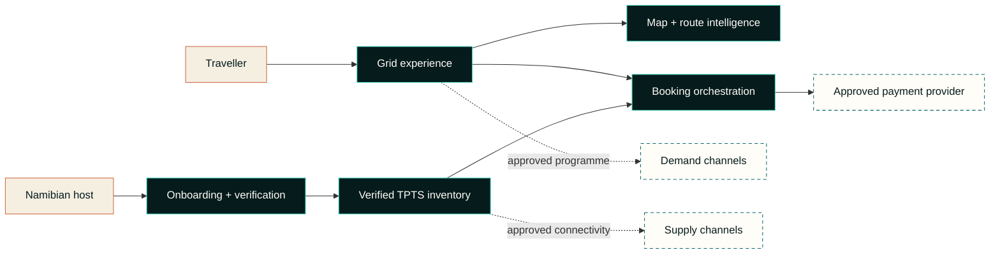

# TPTS Grid

> **Namibia moves through here.**  
> Book the road, not just the room.

TPTS Grid is a Namibia-first travel network conceived for the whole journey: discovery, route thinking, direct property onboarding and a secure path to booking. It is designed around how Namibia is actually experienced—long roads, changing surfaces, sparse signal, destination clusters and the independent places that make the route worth travelling.

This is the public product case study. The production application, credentials, commercial agreements, infrastructure configuration and payment implementation remain in a private repository.

## At a glance

| | |
| --- | --- |
| **Market** | Namibia, with a route to wider SADC relevance |
| **Product** | Destination discovery, itinerary planning, property onboarding and booking orchestration |
| **Core idea** | Treat the route—not only the room—as the primary travel object |
| **Map** | Interactive Namibia map with real public destination anchors and TPTS-owned overlays |
| **Supply model** | Direct host onboarding with verification before publication |
| **Payments** | TPTS-controlled orchestration boundary; partner API verified, merchant payment activation separately gated |
| **Experience design** | “Desert Signal”: editorial warmth, map intelligence and an unmistakably Namibian visual system |

## The Namibia-native thesis

Global booking products are excellent at selling a bed. Namibia asks for more context.

A traveller may need to understand what comes before and after the stay: the next fuel stop, a realistic route sequence, the character of a gravel corridor, whether a detour improves the journey, and which independent place belongs on the map. At the same time, a small lodge, guest farm, campsite or community stay should not need enterprise software to become discoverable.

Grid turns those constraints into product advantages:

- **The route is the interface.** Places become part of a coherent journey rather than isolated cards in a catalogue.
- **Local supply can enter directly.** A guided onboarding flow lets a host submit a place and pin its location; publication remains subject to verification.
- **Geography is product data.** Destination anchors, corridors and planning context are kept distinct from bookable inventory.
- **Trust is visible.** The interface distinguishes directories, applications, verified places and live inventory instead of implying availability that does not exist.
- **Local control matters.** TPTS retains the customer experience and orchestration layer while external channels remain optional, governed integrations.

## Experience pillars

### 01 · Explore Namibia spatially

Grid opens on a real map, not a generic search form. TPTS overlays connect public destination anchors into legible travel corridors. Every public pin is labelled honestly: a destination anchor is not automatically a property, partner or live room.

### 02 · Compose a journey

Travellers can express intent—coast, desert, wildlife, southern route, remote country—and receive a reversible route suggestion. The interface explains its changes and never presents generated guidance as live inventory, road-condition advice or confirmed availability.

### 03 · Let places join the Grid

Property owners can describe a place, identify its location and submit contact details through a short, progressive workflow. New submissions enter a verification queue. Nothing is silently published and no relationship with a third-party marketplace is implied.

### 04 · Make payment a trust boundary

The experience owns the booking intent and total; sensitive card entry belongs on an approved provider-controlled surface. A booking cannot become paid merely because a browser reports success. TPTS has verified the partner API connection against the permitted read-only services endpoint, while payment creation remains locked behind a separately authorised merchant profile, server-side secret configuration and independent security review.

### 05 · Connect selectively

Grid is designed to stand on its own. Approved channel connections can extend demand or inventory reach without becoming the product's identity.

## Public architecture view

The production design separates experience, inventory, payment orchestration and external channels. That separation is deliberate: it limits coupling, makes provenance visible and allows a channel to be added—or removed—without rebuilding the core journey.

Read the [public architecture notes](docs/architecture.md) for the boundaries and data classifications that can safely be disclosed.

## Verified external pathways

These are programme pathways, not claims that a production connection is already enabled. Status was last checked on **15 October 2026** against the providers' official public documentation.

| Pathway | What is publicly verified | Current Grid position |
| --- | --- | --- |
| [Booking.com Demand API](https://developers.booking.com/demand/docs/getting-started/prerequisites) | Access requires registration as a Managed Affiliate Partner, Partner Centre access and issued API credentials. Supported product flows range from content/redirect to integrated booking, subject to approval. | Application and commercial approval required; no credential or live-inventory claim is made here. |
| [Booking.com Connectivity](https://connect.booking.com/?lang=en) | The portal supports property, rates, availability and reservation connectivity, but currently states that new connectivity-provider integrations are paused. Individual properties are directed to existing channel managers. | Monitor the intake pause; do not design the core platform around an unavailable approval path. |
| [Expedia Group lodging connectivity](https://developers.expediagroup.com/supply/lodging) | Expedia publishes a five-stage path: contact, PCI/licence review, consultation, development and testing, then go-live. Direct API connections from individual properties are not accepted. | Prepare a provider application and compliance pack; enable only after programme acceptance. |
| [CallPay merchant integration](https://www.callpay.com/merchant-general-terms/) | CallPay's public merchant terms state that service-specific Integration Documents are supplied after merchant acceptance. | The documented partner API connection has been verified for its permitted scope. Payment creation stays disabled until a distinct merchant-scoped profile, currency support and compliance obligations are confirmed. |

No API key, affiliate identifier, merchant credential, webhook contract or proprietary request shape is included in this repository.

## Brand: Desert Signal

The visual language rejects the usual collage of stock dunes, generic safari gold and floating white cards. Instead, it combines three Namibian signals:

- **Atlantic depth** — dark teal and fog tones evoke the coast and give the map a confident night-mode foundation.
- **Desert warmth** — dune clay and sun accents add humanity without turning the product into a tourism cliché.
- **Route intelligence** — a compact data typeface, measured overlays and a convergence mark make movement visible.

The logo concept is a **Convergence Mark**: multiple paths meeting in one navigable system. The wordmark is direct and geometric; the motion language feels spring-loaded and alive, but always yields to reduced-motion preferences.

See the [public design-system notes](docs/design-system.md).

## Trust by design

Grid's public product commitments are straightforward:

- server-owned booking totals and references;
- provider-hosted entry for sensitive payment details;
- verified provider confirmation before a paid state is recorded;
- encrypted transport and secrets kept outside browser code and version control;
- least-privilege access for operational tools;
- explicit state labels for destination anchors, applicants, verified places and live inventory;
- data minimisation and purpose-limited collection;
- user-triggered location access with a manual alternative;
- a human verification gate before host submissions become public.

The operative privacy terms belong to [TPTS Namibia](https://www.tptsnam.com/privacy-policy/). Security concerns should follow [SECURITY.md](SECURITY.md), never a public issue.

## Accessibility and resilient performance

The product is designed for keyboards, assistive technology, small screens and variable connectivity from the beginning:

- semantic landmarks, a skip link and visible focus states;
- labelled dialogs and controls, focus trapping and focus restoration;
- status copy that does not rely on colour alone;
- reduced-motion support for animation and programmatic scrolling;
- minimum touch targets and responsive layouts tested around phone viewports;
- map controls paired with a text directory and manual coordinate fallback;
- lazy loading for secondary map surfaces;
- local font assets and a static visual fallback if the network map cannot load;
- progressive disclosure so complex host and trip-planning tasks remain comprehensible.

The map uses [MapLibre GL JS](https://maplibre.org/) with [OpenFreeMap](https://openfreemap.org/) styles and [OpenStreetMap contributors](https://www.openstreetmap.org/copyright). A production-scale deployment can replace the public style endpoint with TPTS-controlled Namibia tiles without coupling that choice to inventory or routing.

## Project status

Grid is a **private pilot / production candidate**, not a promise of a fully live marketplace.

| Capability | Status |
| --- | --- |
| Namibia map and public destination directory | Implemented |
| Intent-led route composition | Implemented; planning aid only |
| Direct host application flow | Implemented with verification gating |
| Persistent operational data layer | Implemented in the private application |
| OneGate / CallPay partner API | Verified against the permitted read-only services endpoint |
| Payment safety boundary | Implemented; merchant-scoped payment activation gated |
| Booking.com Demand API | Path verified; application not represented as approved |
| Booking.com supply connectivity | New-provider intake publicly paused |
| Expedia Group lodging connectivity | Path verified; application/approval required |
| Commercial inventory and live availability | Planned; activation requires verified properties, inventory and approved channels |

## Links

- **Launch URL:** [tpts-grid.pages.dev](https://tpts-grid.pages.dev) *(live production discovery and onboarding pilot)*
- **TPTS Namibia:** [tptsnam.com](https://www.tptsnam.com/)
- **TPTS privacy policy:** [tptsnam.com/privacy-policy](https://www.tptsnam.com/privacy-policy/)
- **Product enquiries:** [info@tptsnam.com](mailto:info@tptsnam.com)
- **Experience portfolio:** [SolarSpin Technologies](https://solarspin-namibia.pages.dev/)

## About this repository

This repository exists to document the thinking, public architecture and design decisions behind TPTS Grid. It is intentionally **not** the production source tree and cannot be used to deploy, operate or reproduce the service.

Please read [CONTRIBUTING.md](CONTRIBUTING.md) before proposing a correction. This repository is publicly viewable but not open source; see [LICENSE](LICENSE).

---

**TPTS Grid** — Built on Namibian ground.  
**A Digital Experience by [SolarSpin Technologies](https://solarspin-namibia.pages.dev/).**
