# TPTS Grid

> **Namibia moves through here.**  
> Book the road, not just the room.

TPTS Grid is a Namibia-first travel network for spatial discovery, traveller-owned route planning and direct property onboarding. Its current public release makes Namibia easier to explore without pretending that a sourced map record is a partner, that a route line is navigation, or that an integration pathway is live inventory.

This is the public product case study. The production source, credentials, commercial agreements, private host submissions and payment implementation are not published here.

## Current product snapshot

The 16 October 2026 release centres on three connected surfaces:

- **Route Studio** starts with a clean canvas. A traveller can search real Namibian destination anchors, add up to 12 stops, remove or reorder them, name the trip, set its length, keep it in local browser storage and share it deliberately. Its connecting line shows journey order, not turn-by-turn navigation or live road conditions.
- **Three map modes**—Field, Atlas and Signal—switch between attributed OpenFreeMap styles over OpenStreetMap data. They are visual lenses over the same product truth; changing the style does not change inventory or route facts.
- **The real Namibia index** contains **28 factual public property records**, of which **27 have exact, individually attributed OpenStreetMap points**. All 28 are currently unclaimed directory records with no TPTS inventory, rate or availability attached.

The public product also includes 21 geographic destination anchors. Destination anchors and property records are intentionally different datasets: one supports route context; the other provides a minimal, correctable path for a real property to be found and claimed.

*Representative current-product capture, 16 October 2026. The screen demonstrates Route Studio and its planning-language boundary; it is not evidence of live room inventory, an OTA connection or payment activation.*

## Product truth at a glance

| Surface | What is implemented or publicly present | What is deliberately not claimed |
| --- | --- | --- |
| Route Studio | Editable, locally saved trip order across real destination anchors | Turn-by-turn routing, live road conditions, availability or a reservation |
| Map | Field, Atlas and Signal modes; accessible status and text fallbacks | That a map point is a partner or a bookable room |
| Property directory | 28 independently checked factual records; 27 exact OSM points | Copied OTA descriptions, photos, ratings, reviews, prices or availability |
| Property records | Official link, locality, source provenance, claim and correction paths | Operator control until authority has been verified |
| Owner onboarding | A three-step private submission and verification queue | Automatic publication, verification or bookability |
| Owner workspace | A signed-in, read-only view of applications tied to the verified account | Editing, operator review controls, inventory activation or access to other owners' records |
| Integration launchpad | 15 public programme paths classified by readiness | Credentials, approval, signed agreements or live production access |
| Payments | A guarded server-side architecture and readiness boundary | Live payment creation or automatic paid-state confirmation |

## From discoverable to claimed to bookable

Grid exposes a simple public promise while keeping the operational gates explicit.

| Public truth state | Evidence required | Current meaning |
| --- | --- | --- |
| **Discoverable** | Independently checked name, locality, official website and source provenance | A factual directory shell. It is unclaimed, not a TPTS partnership and not bookable. All 28 current public records are here. |
| **Claimed** | Verified authority to represent the property plus owner-licensed content | The operator can maintain its truth. Claiming does not create inventory, a rate or a booking channel. |
| **Bookable** | Claimed property, activated and fresh inventory, policies, commercial approval and an approved payment/reconciliation path | A separately gated future state. No current public directory record is presented as bookable. |

Owners can start a claim from a property card or factual record page. Every record also offers a direct **correct / remove** route that does not require an account. A correction, ownership claim or removal request is a governance action, not a commercial conversion.

## Route Studio: traveller-owned planning

Route Studio turns the route into the primary travel object without locking the traveller into an opaque generated itinerary.

- search, add, remove and reorder real destination anchors;
- change the trip name and number of nights;
- see an optional, explainable suggestion that can be accepted or undone;
- store the draft locally on the device and share only on request;
- retain a text-first editing surface when the basemap is degraded;
- label direct-line distance and journey order honestly, with no road-kilometre or navigation claim.

The main exploration surface can suggest a route from a brief such as coast, desert or wildlife. Suggestions remain editable and carry no inventory, price, road-safety or availability authority.

## Property discovery and owner onboarding

The directory is intentionally factual and sparse. Public seed records use only independently checked names, localities, regions, official websites and sourced coordinates. They do not reproduce third-party photography, logos, descriptions, ratings, reviews, room types, prices or availability.

The owner path has three progressive steps:

1. identify the property and set a public-facing map point, with manual coordinates as a fallback;
2. provide operating context such as property type, room/unit count, website and traveller-relevant notes;
3. provide private contact details, attest authority and submit to the TPTS verification queue.

Contact details and verification evidence remain private. Marketing consent is separate and optional. A submitted draft enters `verification_required`; it is not silently published and cannot become bookable without later inventory activation.

In the current source, a signed-in owner can use the read-only owner workspace to follow applications attached to that verified account. The workspace reads the existing application records; it does not edit them, publish owner content, verify authority or activate inventory. Identity is checked at the server boundary; on ordinary Pages and other non-Sites deployments the account view fails closed, and the browser never receives or uses the operator review token.

## Safe integration launchpad

Grid exposes an integration research surface, not an integration trophy case. The launchpad was reviewed on **16 October 2026** and classifies 15 paths without asserting credentials or production access.

| Stage | Paths | Meaning |
| --- | --- | --- |
| **Owned** | TPTS Direct | The canonical discovery, claim and future native-inventory direction belongs to TPTS. |
| **Ready with attribution** | OpenStreetMap + Wikidata | Public facts and geographic provenance only; never availability or partner status. |
| **Apply** | Booking.com Demand, Expedia Rapid, Hostelworld, ResRequest ResConnect, NightsBridge | A public application, affiliate, NDA/audit or commercial relationship path exists. TPTS approval is not claimed. |
| **Evaluate** | Hotelbeds / HBX, Google Hotel Center, Travelgate Hotel-X, Channex, Wetu | Technically relevant later paths whose value depends on agreements, certification and a mature native inventory model. |
| **Restricted** | Booking.com Connectivity, Amadeus Hotels, Airbnb | Intake or access constraints make these unsuitable as launch dependencies. |

The UI links each card to an official programme page and states the next legitimate action. It does not scrape inventory, invent partner status or place an external channel inside the canonical TPTS record. See the dated [public verification register](docs/verification-register.md).

## Payment is a hard boundary

TPTS Flow models how a future checkout must be controlled without claiming that checkout is live today:

- totals, currency and merchant references originate on the server;
- the current OneGate partner profile is limited to the authorised read-only services check and is not a merchant payment profile;
- live payment creation remains disabled until a distinct merchant-scoped organisation ID and API salt, supported currency, compliance approval and an operational runbook are in place;
- when enabled, sensitive card or banking entry belongs on the provider-controlled surface, not in TPTS screens, logs or storage;
- a redirect, browser callback or success-looking screen can never mark a booking paid;
- automatic confirmation remains disabled until a documented provider-originated verification mechanism is implemented, replay-safe and reviewed.

There is **no claim of live payment processing** in this case study.

## Responsive, accessible and mobile work

The October release includes implementation work for keyboard, assistive-technology and phone use. This is an engineering baseline, not an accessibility certification.

- semantic landmarks, a skip link, labelled regions and meaningful control names;
- keyboard-operable destination markers and a trapped, restorable command dialog;
- `aria-live` status for map, route, submission and readiness changes;
- visible text labels alongside colour-coded states;
- reduced-motion handling for map movement, reveals and decorative animation;
- a synchronized directory and manual-coordinate alternative when the map cannot be used;
- a dedicated mobile dock, safe-area handling, single-column property and integration views, and 44–52 px primary touch targets at phone breakpoints;
- 16 px mobile form text to avoid focus zoom, scrollable long dialogs and simplified map labels on narrow screens;
- lazy loading for secondary map instances and a same-origin MapLibre worker plus a network-free fallback style.

## Dependency health snapshot

The product lockfile was audited on **16 October 2026** with pnpm 11.25.0. The result is intentionally reported in two scopes:

| Audit scope | Result | Interpretation |
| --- | --- | --- |
| `pnpm audit --prod --json` | 0 known advisories across the production dependency set reported by pnpm | No registry advisory was reported for the installable production graph at audit time. This is not a guarantee of absence. |
| `pnpm audit --json` | 34 advisories: 15 high, 13 moderate, 6 low, 0 critical | The full development/build graph is **not clean**. Every reported finding was marked as a development dependency path, including transitive build and local-server tooling. |

The development findings remain release-engineering work: keep preview servers non-public, update or override affected transitive packages when compatible releases exist, rerun the full audit after every lockfile change, and do not describe the product as “zero vulnerability.” The full product-side record is maintained with the private source because registry results change over time.

## Public architecture view

```mermaid
flowchart LR
    T[Traveller] --> R[Route Studio]
    T --> D[Public place directory]
    O[Property operator] --> C[Claim or new private draft]
    C --> V[Authority verification]
    D --> U[Discoverable / unclaimed]
    U --> C
    V --> K[Claimed / owner-maintained]
    K -. inventory + policy + commercial gates .-> B[Bookable]
    B -. merchant + verification gates .-> P[Provider-hosted payment]
    B -. approved adapter only .-> X[External channel]

    classDef live fill:#061b1c,stroke:#42d5bd,color:#fffdf7;
    classDef truth fill:#f5efe2,stroke:#ce6842,color:#061b1c;
    classDef gated fill:#fffdf7,stroke:#0d6872,color:#061b1c,stroke-dasharray:5 4;
    class R,D,U,C,V live;
    class T,O,K truth;
    class B,P,X gated;
```

Read the [public architecture notes](docs/architecture.md) for the data boundaries and transition rules that can safely be disclosed.

## Brand: Desert Signal

The visual system combines Atlantic depth, dune warmth and precise route language. The Convergence Mark represents paths meeting in one navigable system. Map modes change atmosphere without changing truth, and motion yields to reduced-motion preferences.

See the [public design-system notes](docs/design-system.md).

## Project status

Grid is a **live production discovery and onboarding pilot**, not a live accommodation marketplace.

| Capability | Status on 16 October 2026 |
| --- | --- |
| Namibia destination map | Live; 21 public geographic anchors |
| Map appearance | Field, Atlas and Signal modes live |
| Route Studio | Live; editable, local-first planning aid |
| Factual property directory | Live; 28 records, 27 exact attributed OSM points |
| Claim, correction and removal paths | Live; claims still require authority verification |
| Direct owner application | Live as a private verification-queue submission |
| Signed-in owner workspace | Implemented as a read-only account view; requires trusted Sites identity at runtime |
| Claimed owner-managed public records | Gated by verification; not represented as current inventory |
| Commercial inventory and OTA availability | Not live |
| Integration launchpad | Live as programme research and readiness guidance only |
| OneGate / CallPay partner diagnostic | Verified only for its permitted read-only scope |
| Live payment creation and paid-state confirmation | Disabled |

## Links

- **Pilot:** [tpts-grid.pages.dev](https://tpts-grid.pages.dev)
- **TPTS Namibia:** [tptsnam.com](https://www.tptsnam.com/)
- **TPTS privacy policy:** [tptsnam.com/privacy-policy](https://www.tptsnam.com/privacy-policy/)
- **Product enquiries and correction requests:** [info@tptsnam.com](mailto:info@tptsnam.com)
- **Experience portfolio:** [SolarSpin Technologies](https://solarspin-namibia.pages.dev/)

## About this repository

This repository documents the public product, architecture and design decisions behind TPTS Grid. It is intentionally **not** the production source tree and cannot be used to deploy, operate or reproduce the service.

Please read [CONTRIBUTING.md](CONTRIBUTING.md) before proposing a correction. This repository is publicly viewable but not open source; see [LICENSE](LICENSE).

---

**TPTS Grid** — Built on Namibian ground.  
**A Digital Experience by [SolarSpin Technologies](https://solarspin-namibia.pages.dev/).**
