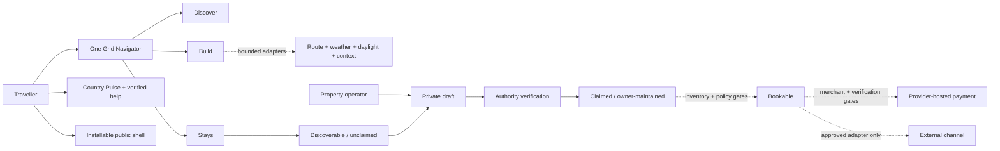

# TPTS Grid

> **Namibia moves through here.**  
> Book the road, not just the room.

TPTS Grid is a Namibia-first travel network for spatial discovery, traveller-owned route planning and direct property onboarding. The production pilot makes Namibia easier to explore without pretending that a public map record is a partner, a route estimate is navigation or a researched integration path is live inventory.

The canonical customer surface is [tpts-grid.pages.dev](https://tpts-grid.pages.dev), hosted on Cloudflare Pages.

This repository is the public product case study. It contains no production source, environment configuration, credentials, customer information, private host submissions, operational runbooks or private commercial agreements.

## Current product snapshot

The 18 October 2026 release is organised around one cinematic countryfront and one shared traveller map:

- **22 destination anchors** provide sourced geographic context across Namibia.
- **One Grid Navigator** preserves place and route state while travellers switch between three primary lenses: **Discover**, **Build** and **Stays**.
- **Build** starts with the traveller, not a preloaded itinerary. A route can contain up to 12 chosen stops and supports add, remove, reorder, trip name, duration, local save, deliberate share and a static Offline Route Pack.
- **TPTS Road Intelligence** combines provider-routed road geometry and estimates from openrouteservice with MET Norway point forecasts. A provider failure falls back visibly to direct-line context and withholds road kilometres and drive time.
- Five subordinate evidence views inside Build—route, daylight, weather, essentials and living context—reuse the same map. They do not create five competing maps.
- **Country Pulse** brings latest-model MET weather, sunrise/sunset and NASA POWER climate context together with dated UK FCDO source links and verified Namibian help contacts. It is planning context, not an observation, emergency feed or safety verdict.
- **28 factual stays** form a correctable public directory: 17 OSM nodes, 10 OSM geometry centroids and one record without a guessed coordinate. They carry no copied OTA description, price, rating, review, availability or partner claim.
- **Direct owner onboarding** collects a private draft for verification. Submission does not silently publish a property, create inventory or make it bookable.
- **35 integration paths** are classified by evidence rather than ambition: 1 owned, 8 live, 3 build-ready, 8 apply, 12 evaluate and 3 restricted.
- **TPTS Flow** contains a guarded OneGate API V2 server boundary. The supplied partner scope is read-only; live checkout remains disabled until a separate merchant-scoped profile and a reviewed confirmation mechanism exist.
- **Desert Day** and **Astro Night** change the complete visual journey—not only the header—while preserving semantic state, contrast and readable fallbacks.
- The installable **PWA boundary** includes a standalone manifest, install affordance, icons and a deliberately narrow offline safety shell. API, owner, listing, booking and payment responses are excluded from offline caching.

The visual system now uses **10 licensed, source-linked Namibia photographs** and **3 original AI-assisted photorealistic TPTS campaign compositions** inspired by real Deadvlei, Sandwich Harbour and Etosha landscapes. The compositions are labelled as such and never stand in for documentary evidence, a property or bookable supply. See the [image provenance register](docs/image-provenance.md).

The retained [earlier Route Studio capture](assets/tpts-grid-route-studio-live-2026-10-16.jpg) is release history. It is not presented as the current information architecture or proof of inventory, an OTA connection or payment activation.

## Product truth at a glance

| Surface | Current posture | What is deliberately not claimed |
| --- | --- | --- |
| Countryfront | Desert Day / Astro Night, Geologica display and brand typography, IBM Plex Sans UI, IBM Plex Mono data text, cinematic motion and reduced-motion handling | That atmosphere or motion proves product state |
| Namibia imagery | 10 licensed photographs plus 3 clearly labelled AI-assisted photorealistic campaign compositions | That an image proves a listing, operator relationship, room, price or availability |
| Grid Navigator | One traveller map with Discover, Build and Stays primary lenses | Turn-by-turn navigation, road access, safety, availability or reservation proof |
| Build intelligence | Route, daylight, forecast, climate, event and aggregate biodiversity context with independent provider states | Comprehensive coverage, an official warning, wildlife prediction or a safe-route verdict |
| Country Pulse | Latest-model weather and daylight, regional climate memory, FCDO source links and verified Namibian contacts | Live observation, personalised immigration advice, emergency triage or safety guarantee |
| Offline support | Installable PWA plus cached public safety shell and traveller-created static route export | Offline basemap, current weather, current inventory, booking storage or live payments |
| Property directory | 28 independently checked factual stays and 27 sourced map points | Copied OTA content, partnership, rates, reviews, availability or operator control |
| Owner onboarding | Three-step private submission into a verification-required state | Automatic publication, verification, inventory or bookability |
| Integration launchpad | 35 evidence-labelled paths: 1 owned, 8 live, 3 build-ready, 8 apply, 12 evaluate, 3 restricted | Credentials, approval, contracts or inventory for any non-live path |
| Payments | Guarded OneGate server adapter and readiness boundary | Live payment creation, automatic confirmation or a merchant profile |

## One map, three primary lenses

The Navigator changes the task without moving the traveller into a different geographic product:

- **Discover** searches the 22 destination anchors and opens local context, route and nearby-stay actions.
- **Build** makes the chosen route the primary object. Suggestions are optional, explainable and reversible; travellers can begin from an empty route and keep control of every stop.
- **Stays** synchronises the shared map with the factual public property ledger. A sourced coordinate remains a geographic fact, not a commercial claim.

Inside Build, the route evidence dock changes the overlay and evidence panel on that same map. Road truth, daylight, weather, route essentials and living context degrade independently. The base map and text-first route editor remain useful when a provider or map layer fails.

The **Offline Route Pack** is a generated static file containing the chosen stops, last available route context, sources, timestamps, limitations and core Namibian help contacts. It does not update itself and is not an offline navigation product.

## Country Pulse and help in Namibia

Country Pulse deliberately separates useful context from authority:

- MET Norway provides latest-model point forecasts and time-stamped weather context;
- MET Norway Sunrise provides dated solar context;
- NASA POWER provides regional climatology, not current weather;
- GOV.UK Content API provides a dated link into general UK FCDO Namibia guidance under the Open Government Licence;
- sourced contacts include `112` mobile emergency, `10111` NAMPOL, `9682` MVA Fund road-crash response, Windhoek emergency services, the Tourist Protection Unit and the Ministry Emergency Operations Centre helpline.

Coverage can vary, especially outside cities. TPTS does not auto-dial, triage emergencies or turn external guidance into a safety guarantee. The offline shell keeps core contacts close while explicitly marking maps, forecasts, listings, bookings and payments as unavailable offline.

## From discoverable to claimed to bookable

| Public truth state | Evidence required | Current meaning |
| --- | --- | --- |
| **Discoverable** | Checked name, locality, official website and source provenance | A factual, correctable public shell. All 28 current records are unclaimed, not TPTS partners and not bookable. |
| **Claimed** | Verified authority plus operator-licensed content | The operator may maintain its facts. Claiming does not create inventory, a rate or a booking channel. |
| **Bookable** | Claimed property, fresh inventory, policies, commercial authority and approved payment/reconciliation | A separately gated future state. No current directory record is presented as bookable. |

Every public record provides a claim path and an account-free correction/removal path. Owner contact details and evidence stay private. The customer surface does not claim a live authenticated owner workspace.

## Integration readiness

`Live` has a narrow meaning: a deployed provider-backed capability with attribution, limitations and a tested fallback. It never means TPTS has a partnership with the provider.

| Stage | Count | Current paths |
| --- | ---: | --- |
| **Owned** | 1 | TPTS Direct |
| **Live** | 8 | OpenStreetMap foundation, MET Norway Weather, openrouteservice, MET Norway Sunrise 3.0, NASA POWER, GBIF Biodiversity, NASA EONET, GOV.UK Content API |
| **Build-ready** | 3 | OSM Route Essentials, Wikidata + Wikimedia Commons, GDACS |
| **Apply** | 8 | Nager.Date v4, Open-Meteo Air Quality, WhatsApp Cloud API, Booking.com Demand, Expedia Rapid, Hostelworld, ResRequest ResConnect, NightsBridge |
| **Evaluate** | 12 | GlobalPetrolPrices API, Smithsonian Open Access, NASA FIRMS, Cloudflare Workers AI + Vectorize, TPTS Offline Grid Pack, Frankfurter FX, Cloudflare Turnstile, Hotelbeds / HBX, Google Hotel Center, Travelgate Hotel-X, Channex, Wetu |
| **Restricted** | 3 | Booking.com Connectivity, Amadeus Hotels, Airbnb |

The interface links each path to its official programme and next legitimate action. It does not scrape inventory, infer approval or confuse Booking.com Demand access with Connectivity-provider approval. See the dated [verification register](docs/verification-register.md).

## Payment is a hard boundary

TPTS Flow models a future provider-hosted checkout without claiming payment activation:

- the server owns the booking total, currency and merchant reference;
- the current OneGate partner scope is used only for an authorised read-only services check;
- partner credentials cannot be repurposed as a merchant payment profile;
- live payment creation remains disabled until a distinct merchant-scoped organisation ID and API salt, supported currency, compliance approval and operating runbook exist;
- card or banking details belong on the provider-controlled surface when enabled;
- no redirect, browser callback or success-looking screen can mark a booking paid;
- automatic confirmation remains disabled until a documented, replay-safe provider verification mechanism is implemented and reviewed.

There is **no claim of live payment processing** in this case study.

## Responsive, accessible and installable baseline

The current release includes:

- semantic landmarks, skip navigation, labelled regions and meaningful control names;
- keyboard-operable task tabs, map markers and dialogs with focus containment and restoration;
- text labels alongside colour-coded state and live regions for material async changes;
- reduced-motion paths for map movement, scene transitions, reveals and decorative animation;
- 320 px, 390 px, tablet, laptop and wide-desktop layouts with safe-area-aware navigation;
- a text/list alternative wherever the map carries meaningful selection state;
- an install prompt where supported and explicit iOS “Add to Home Screen” guidance;
- a service worker that caches only safe public shell/media resources and never caches API, owner, listing, booking or payment responses.

This is an engineering baseline, not a formal accessibility certification or an offline-availability guarantee.

## Public architecture view

Read the [public architecture notes](docs/architecture.md) for the disclosed system boundaries.

## Visual system

The countryfront is deliberately cohesive without becoming monotonous:

1. **Cinematic opening.** Real-place cues and clearly labelled original compositions create desire before the product becomes technical.
2. **One geographic instrument.** The Grid Navigator receives the deepest, most focused visual chapter and remains the traveller's only persistent map.
3. **Real Namibia in the page rhythm.** Windhoek, Swakopmund, Sossusvlei, Fish River Canyon, Skeleton Coast, Etosha, Nyae Nyae, the Okavango and Spitzkoppe appear through licensed, source-linked photography.
4. **Two complete light cycles.** Desert Day uses cream, sand, mist, Atlantic teal, clay and sun; Astro Night moves the entire journey into mineral green-black, warm ochre and luminous aqua.
5. **One type voice.** Geologica carries brand/display hierarchy; IBM Plex Sans carries controls and reading; IBM Plex Mono carries coordinates, source stamps and compact state.

Motion is springy and spatial but never required to understand the product. Hover treatments are limited to hover-capable devices and every non-essential animation has a reduced-motion path.

See the [design-system notes](docs/design-system.md) and [image provenance register](docs/image-provenance.md).

## Project status

Grid is a **live production discovery, route-planning and onboarding pilot**, not yet a live accommodation marketplace.

| Capability | Status on 18 October 2026 |
| --- | --- |
| Cinematic Namibia countryfront | Live; Desert Day / Astro Night, responsive scene system and reduced-motion handling |
| Image provenance | Live; 10 licensed photographs and 3 labelled AI-assisted photorealistic TPTS campaign compositions |
| Grid Navigator | Live; one traveller map with Discover, Build and Stays primary lenses |
| Destination anchors | Live; 22 public geographic anchors |
| Road and route intelligence | Live; openrouteservice, MET Norway, Sunrise, NASA POWER, EONET and aggregate-only GBIF behind bounded adapters |
| Country Pulse | Live; latest-model context, FCDO source link, verified help contacts and explicit limitations |
| Public stays | Live; 28 factual, correctable records with 27 sourced map points |
| Direct owner application | Live as a private verification-required submission; authenticated workspace remains gated |
| Installable PWA | Live; standalone manifest, install affordance and safety-only offline shell |
| Integration launchpad | Live; 35-path evidence catalogue: 1 owned, 8 live, 3 build-ready, 8 apply, 12 evaluate, 3 restricted |
| Commercial inventory and OTA availability | Not live |
| OneGate / CallPay partner diagnostic | Guarded and verified only for authorised read-only scope |
| Live payment creation and paid-state confirmation | Disabled |

## Production verification · 18 October 2026

The current release from reviewed private source revision `a7bdf8143ec2258dc555820640c2a237f038768f` is live at [tpts-grid.pages.dev](https://tpts-grid.pages.dev). The release gate recorded successful type checking, linting, **6/6 tests** and a production build. Browser QA covered wide desktop, laptop, tablet and 390/320 px phone layouts without horizontal overflow or console errors in the tested flows.

Point-in-time delivery checks confirmed HTTP 200 for the canonical root, web app manifest, service worker and offline safety screen, with security headers present. Route-provider evidence remains planning context and not an uptime, latency, navigation, access or safety guarantee.

These checks do not activate booking, inventory, checkout, payment confirmation, partner approval or turn-by-turn navigation.

## Links

- **Canonical customer surface:** [tpts-grid.pages.dev](https://tpts-grid.pages.dev)
- **TPTS Namibia:** [tptsnam.com](https://www.tptsnam.com/)
- **TPTS privacy policy:** [tptsnam.com/privacy-policy](https://www.tptsnam.com/privacy-policy/)
- **Product enquiries and corrections:** [info@tptsnam.com](mailto:info@tptsnam.com)
- **Experience portfolio:** [SolarSpin Technologies](https://solarspin-namibia.pages.dev/)
- **Image provenance:** [source, licence and use register](docs/image-provenance.md)

## About this repository

This repository documents public product, architecture, design and evidence decisions behind TPTS Grid. It is intentionally **not** the production source tree and cannot deploy, operate or reproduce the service.

Please read [CONTRIBUTING.md](CONTRIBUTING.md) before proposing a correction. This repository is publicly viewable but not open source; see [LICENSE](LICENSE).

---

**TPTS Grid** — Built on Namibian ground.  
**A Digital Experience by [SolarSpin Technologies](https://solarspin-namibia.pages.dev/).**
