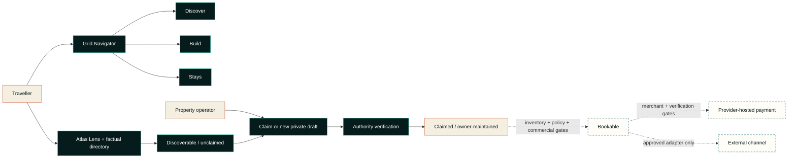

# TPTS Grid

> **Namibia moves through here.**  
> Book the road, not just the room.

TPTS Grid is a Namibia-first travel network for spatial discovery, traveller-owned route planning and direct property onboarding. Its current public release makes Namibia easier to explore without pretending that a sourced map record is a partner, that a route line is navigation, or that an integration pathway is live inventory.

This is the public product case study. The production source, credentials, commercial agreements, private host submissions and payment implementation are not published here.

The canonical customer production surface is [tpts-grid.pages.dev](https://tpts-grid.pages.dev), hosted on Cloudflare Pages.

## Current product snapshot

The 18 October 2026 release is organised around **one shared traveller map**, supported by two deliberately different evidence and host tools:

- **The Grid Navigator** keeps discovery, route composition and factual stay inspection in one geographic workspace. Its three task lenses—**Discover**, **Build** and **Stays**—change the controls and overlay, not the traveller's place in Namibia.
- **Discover** searches 21 real Namibian destination anchors. **Build** lets a traveller add up to 12 stops, remove or reorder them, name the trip, set its length, keep it in local browser storage and share it deliberately. **Stays** filters and selects factual property points without inventing price, availability or partner status.
- **TPTS Road Intelligence** adds live MET Norway point forecasts to the traveller's chosen stops. A bounded server adapter can replace direct-line context with openrouteservice road geometry, distance and estimated drive time only when the optional server key is installed; without it, road kilometres and drive time are visibly withheld.
- **The Atlas Lens** replaces a second directory map with a quieter regional evidence view: **28 factual public property records**, **27 exact, individually attributed OpenStreetMap points** and the distribution of those records across the represented regions.
- **The owner precision map** is not another exploration surface. It stays closed until an operator explicitly opens it to place or review one public-facing point, with manual coordinates retained as a fallback.
- **Field, Atlas and Signal** remain visual map appearances over the same attributed OpenFreeMap/OpenStreetMap context. A style change never alters route order, record state, inventory or trust.

The public product also includes 21 geographic destination anchors. Destination anchors and property records are intentionally different datasets: one supports route context; the other provides a minimal, correctable path for a real property to be found and claimed.

The [previous standalone Route Studio capture](assets/tpts-grid-route-studio-live-2026-10-16.jpg) remains in this repository as release history. The current product folds that capability into the Grid Navigator; the image is not presented as the current information architecture or as evidence of live room inventory, an OTA connection or payment activation.

## Product truth at a glance

| Surface | Current posture | What is deliberately not claimed |
| --- | --- | --- |
| Grid Navigator | One traveller map with Discover, Build and Stays task lenses; live stop weather; provider-routed road geometry when connected | Turn-by-turn navigation, proof of road access or safety, availability or a reservation |
| Map appearance | Field, Atlas and Signal styles; accessible status and text fallbacks | That a style, marker or map point is a partner or a bookable room |
| Atlas Lens and property directory | Regional evidence view plus 28 independently checked factual records; 27 exact OSM points | A duplicate exploration map; copied OTA descriptions, photos, ratings, reviews, prices or availability |
| Property records | Official link, locality, source provenance, claim and correction paths | Operator control until authority has been verified |
| Owner onboarding | A three-step private submission and verification queue | Automatic publication, verification or bookability |
| Owner account access | Gated pending a TPTS-owned identity boundary | That owner authentication, an account workspace, operator controls, publication or inventory activation are live |
| Integration launchpad | 20 public programme paths classified by readiness | Credentials, approval, signed agreements or live production access |
| Payments | A guarded server-side architecture and readiness boundary | Live payment creation or automatic paid-state confirmation |

## From discoverable to claimed to bookable

Grid exposes a simple public promise while keeping the operational gates explicit.

| Public truth state | Evidence required | Current meaning |
| --- | --- | --- |
| **Discoverable** | Independently checked name, locality, official website and source provenance | A factual directory shell. It is unclaimed, not a TPTS partnership and not bookable. All 28 current public records are here. |
| **Claimed** | Verified authority to represent the property plus owner-licensed content | The operator can maintain its truth. Claiming does not create inventory, a rate or a booking channel. |
| **Bookable** | Claimed property, activated and fresh inventory, policies, commercial approval and an approved payment/reconciliation path | A separately gated future state. No current public directory record is presented as bookable. |

Owners can start a claim from a property card or factual record page. Every record also offers a direct **correct / remove** route that does not require an account. A correction, ownership claim or removal request is a governance action, not a commercial conversion.

## The Grid Navigator: one map, three lenses

The Grid Navigator gives the map one clear job at a time without forcing the traveller to restart or jump between competing geographic surfaces.

- **Discover** reads the country through searchable destination anchors, local context and direct actions to add a place or inspect nearby factual stays;
- **Build** turns the route into the primary travel object without locking the traveller into an opaque generated itinerary;
- **Stays** synchronises the map with the factual property ledger so selecting a marker or record updates the same focused context;
- story-led route prompts, directory actions and the command palette deep-link into the relevant lens rather than opening another map.

Within Build, travellers can:

- search, add, remove and reorder real destination anchors;
- change the trip name and number of nights;
- see an optional, explainable suggestion that can be accepted or undone;
- store the draft locally on the device and share only on request;
- retain a text-first editing surface when the basemap is degraded;
- see live point weather across selected stops;
- receive provider-routed road geometry, distance and estimated drive time only from a successful server-side routing response;
- fall back to clearly labelled direct-line context while withholding road kilometres and drive time when routing is not connected.

The Road Intelligence deck makes provider failure visible instead of letting it collapse the itinerary. Weather, route editing and the base map degrade independently. Even a routed result remains planning guidance—not turn-by-turn navigation, proof of access or a road-safety statement.

The cinematic opening composer can suggest a route from a brief such as coast, desert or wildlife, then hands that suggestion into Build. The hero uses real Namibia imagery and an animated route thread instead of running a competing live map behind the primary task. Suggestions remain editable and carry no inventory, price, road-safety or availability authority.

The Atlas Lens is intentionally not a fourth Navigator mode. It is a factual regional ledger that shows record concentration and gaps, then hands a selected set back to Stays when geography is useful.

## Property discovery and owner onboarding

The directory is intentionally factual and sparse. Public seed records use only independently checked names, localities, regions, official websites and sourced coordinates. They do not reproduce third-party photography, logos, descriptions, ratings, reviews, room types, prices or availability.

The owner path has three progressive steps:

1. identify the property and set a public-facing map point, with manual coordinates as a fallback; the precision map mounts only after an explicit operator action;
2. provide operating context such as property type, room/unit count, website and traveller-relevant notes;
3. provide private contact details, attest authority and submit to the TPTS verification queue.

Contact details and verification evidence remain private. Marketing consent is separate and optional. A submitted draft enters `verification_required`; it is not silently published and cannot become bookable without later inventory activation.

Owner authentication and the account workspace are not live on the canonical customer production surface. Both remain gated until TPTS operates an identity boundary that can authenticate an owner and scope records without exposing operator credentials. The public claim, correction/removal and private submission paths remain separate from future authenticated account access.

## Safe integration launchpad

Grid exposes an integration research surface, not an integration trophy case. The launchpad was reviewed on **18 October 2026** and classifies 20 paths without asserting credentials or production access.

| Stage | Paths | Meaning |
| --- | --- | --- |
| **Owned** | TPTS Direct | The canonical discovery, claim and future native-inventory direction belongs to TPTS. |
| **Ready with attribution / terms** | OpenStreetMap + Wikidata, MET Norway Weather, Frankfurter FX | Public geography, point weather and reference exchange data under their respective terms; never availability or partner status. |
| **Apply** | Booking.com Demand, Expedia Rapid, Hostelworld, ResRequest ResConnect, NightsBridge | A public application, affiliate, NDA/audit or commercial relationship path exists. TPTS approval is not claimed. |
| **Evaluate** | openrouteservice, Cloudflare Turnstile, NASA FIRMS, Hotelbeds / HBX, Google Hotel Center, Travelgate Hotel-X, Channex, Wetu | Technically relevant or key-gated paths whose activation depends on configuration, governance, agreements, certification or a mature native inventory model. |
| **Restricted** | Booking.com Connectivity, Amadeus Hotels, Airbnb | Intake or access constraints make these unsuitable as launch dependencies. |

The UI links each card to an official programme page and states the next legitimate action. It does not scrape inventory, invent partner status or place an external channel inside the canonical TPTS record. See the dated [public verification register](docs/verification-register.md).

## Payment is a hard boundary

TPTS Flow models how a future checkout must be controlled without claiming that checkout is live today:

- totals, currency and merchant references originate on the server;
- the current OneGate partner profile is limited to the authorised read-only services check and is not a merchant payment profile;
- live payment creation remains disabled until a distinct merchant-scoped organisation ID and API salt, supported currency, compliance approval and an operational runbook are in place;
- when enabled, sensitive card or banking entry belongs on the provider-controlled surface, not in TPTS screens, logs or storage;
- a redirect, browser callback or success-looking screen can never mark a booking paid;
- automatic confirmation remains disabled until a documented provider-originated verification mechanism is implemented, replay-safe and reviewed.

There is **no claim of live payment processing** in this case study.

## Responsive, accessible and mobile work

The October release includes implementation work for keyboard, assistive-technology and phone use. This is an engineering baseline, not an accessibility certification.

- semantic landmarks, a skip link, labelled regions and meaningful control names;
- keyboard-operable destination markers and a trapped, restorable command dialog;
- `aria-live` status for map, route, submission and readiness changes;
- visible text labels alongside colour-coded states;
- reduced-motion handling for map movement, reveals and decorative animation;
- a synchronized directory and manual-coordinate alternative when the map cannot be used;
- a dedicated mobile dock, safe-area handling, single-column property and integration views, and 44–52 px primary touch targets at phone breakpoints;
- 16 px mobile form text to avoid focus zoom, scrollable long dialogs and simplified map labels on narrow screens;
- lazy loading for secondary map instances and a same-origin MapLibre worker plus a network-free fallback style.

## Dependency health snapshot

The product lockfile was audited on **16 October 2026** with pnpm 11.25.0. The result is intentionally reported in two scopes:

| Audit scope | Result | Interpretation |
| --- | --- | --- |
| `pnpm audit --prod --json` | 0 known advisories across the production dependency set reported by pnpm | No registry advisory was reported for the installable production graph at audit time. This is not a guarantee of absence. |
| `pnpm audit --json` | 34 advisories: 15 high, 13 moderate, 6 low, 0 critical | The full development/build graph is **not clean**. Every reported finding was marked as a development dependency path, including transitive build and local-server tooling. |

The development findings remain release-engineering work: keep preview servers non-public, update or override affected transitive packages when compatible releases exist, rerun the full audit after every lockfile change, and do not describe the product as “zero vulnerability.” The full product-side record is maintained with the private source because registry results change over time.

## Public architecture view

Read the [public architecture notes](docs/architecture.md) for the data boundaries and transition rules that can safely be disclosed.

## Brand: Desert Signal

The visual system combines Atlantic depth, dune warmth and precise route language. The Convergence Mark represents paths meeting in one navigable system. A cinematic Namibia opening establishes place; the Grid Navigator handles geography; the Atlas Lens handles evidence; and the owner precision tool handles one coordinate. Map appearances change atmosphere without changing truth, and motion yields to reduced-motion preferences.

See the [public design-system notes](docs/design-system.md).

## Project status

Grid is a **live production discovery and onboarding pilot**, not a live accommodation marketplace.

| Capability | Status on 18 October 2026 |
| --- | --- |
| Grid Navigator | Live; one traveller map with Discover, Build and Stays lenses |
| Namibia destination anchors | Live; 21 public geographic anchors |
| Map appearance | Field, Atlas and Signal modes live |
| Build lens | Live; editable, local-first planning aid |
| TPTS Road Intelligence | Live; MET Norway stop forecasts and truthful direct-line fallback; road routing activates only with the optional server key |
| Stays lens and factual property directory | Live; 28 records, 27 exact attributed OSM points |
| Atlas Lens | Live; factual regional distribution view, not a second traveller map |
| Owner precision map | Live on demand inside onboarding; one public-facing point only |
| Claim, correction and removal paths | Live; claims still require authority verification |
| Direct owner application | Live as a private verification-queue submission |
| Owner authentication and account workspace | Gated; pending TPTS-owned identity and not live on the customer production surface |
| Claimed owner-managed public records | Gated by verification; not represented as current inventory |
| Commercial inventory and OTA availability | Not live |
| Integration launchpad | Live as programme research and readiness guidance only |
| OneGate / CallPay partner diagnostic | Verified only for its permitted read-only scope |
| Live payment creation and paid-state confirmation | Disabled |

## Links

- **Canonical customer production surface:** [tpts-grid.pages.dev](https://tpts-grid.pages.dev)
- **TPTS Namibia:** [tptsnam.com](https://www.tptsnam.com/)
- **TPTS privacy policy:** [tptsnam.com/privacy-policy](https://www.tptsnam.com/privacy-policy/)
- **Product enquiries and correction requests:** [info@tptsnam.com](mailto:info@tptsnam.com)
- **Experience portfolio:** [SolarSpin Technologies](https://solarspin-namibia.pages.dev/)

## About this repository

This repository documents the public product, architecture and design decisions behind TPTS Grid. It is intentionally **not** the production source tree and cannot be used to deploy, operate or reproduce the service.

Please read [CONTRIBUTING.md](CONTRIBUTING.md) before proposing a correction. This repository is publicly viewable but not open source; see [LICENSE](LICENSE).

---

**TPTS Grid** — Built on Namibian ground.  
**A Digital Experience by [SolarSpin Technologies](https://solarspin-namibia.pages.dev/).**
