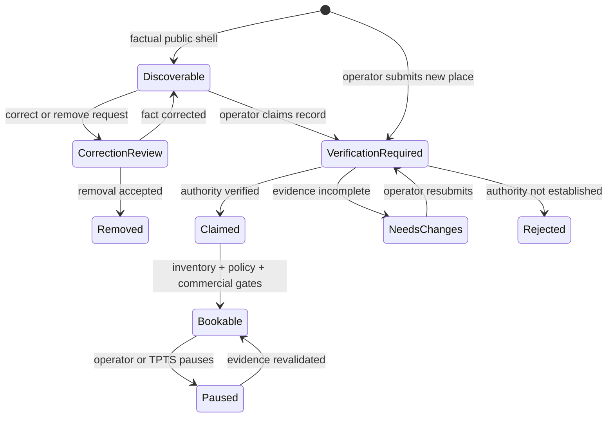

# Public architecture notes

This document explains TPTS Grid at a system-boundary level. It intentionally omits production source, endpoints, schemas, credentials, infrastructure identifiers and private partner specifications.

## Architectural intent

Grid is organised around one principle: **TPTS owns the journey while integrations remain replaceable edges**.

The core product must still help a traveller discover Namibia, shape a route and let a legitimate operator claim or add a place when a global channel is unavailable. External demand, supply and payment providers can extend that system only through explicit approval gates; they do not define its internal model.

## Current public footprint

As of 16 October 2026, the public product contains:

- 21 destination anchors for geographic route context;
- one Grid Navigator with Discover, Build and Stays task lenses over a shared traveller map;
- traveller-controlled route search, add, remove, reorder, duration, local save and deliberate sharing inside Build;
- three visual map appearances—Field, Atlas and Signal—over the same underlying truth;
- 28 factual property directory records, including 27 exact OSM-sourced points;
- an Atlas Lens that presents regional record distribution without mounting a duplicate directory map;
- a claim path and an account-free correction/removal path for every public record;
- private owner onboarding into a verification queue, with its single-point precision map mounted only on request;
- owner authentication and account visibility held behind a future TPTS-owned identity gate, not claimed as live;
- a 15-path integration launchpad that records programme readiness, not connection status;
- a payment readiness boundary with live creation and paid-state confirmation disabled.

Every current public property record is `unclaimed-directory` with `inventoryStatus: none` and `relationshipStatus: not-a-tpts-partner` in the product source. Those fields are a deliberate public contract, not placeholder marketing copy.

## System context

```mermaid
flowchart LR
    traveller[Traveller] -->|explores, builds and inspects| navigator[Grid Navigator]
    navigator --> discover[Discover lens]
    navigator --> build[Build lens]
    navigator --> stays[Stays lens]
    traveller -->|reads regional evidence| atlas[Atlas Lens]
    atlas -->|opens selected set| stays
    stays -->|reads factual records| directory[Public place directory]
    host[Property operator] -->|claims or submits| onboarding[Private onboarding]
    host -. future authentication .-> ownerIdentity[TPTS-owned identity]
    ownerIdentity -. scoped account access .-> workspace[Owner workspace]
    workspace -. read-only application status .-> onboarding
    onboarding -->|human review| ops[TPTS verification]
    directory -->|attributed facts| maps[Open mapping ecosystem]
    ops --> claimed[Claimed owner record]
    claimed -. inventory + policy gates .-> bookable[Bookable record]
    bookable -. merchant + verification gates .-> payment[Provider-hosted payment]
    bookable -. approved adapter only .-> channels[Travel channels]

    classDef core fill:#061b1c,stroke:#42d5bd,color:#fffdf7;
    classDef human fill:#f5efe2,stroke:#ce6842,color:#061b1c;
    classDef external fill:#fffdf7,stroke:#0d6872,color:#061b1c,stroke-dasharray:5 4;
    class navigator,discover,build,stays,atlas,directory,onboarding,ops core;
    class traveller,host,claimed human;
    class maps,ownerIdentity,workspace,bookable,payment,channels external;
```

## Capability boundaries

### Experience layer

Owns navigation, map interaction, route composition, accessible fallbacks and transparent state labels. The Grid Navigator keeps three tasks in one traveller map: Discover reads destination context, Build composes an editable trip and Stays inspects factual property signals. A cinematic opening composer may suggest an itinerary, but every stop remains editable. Its line is journey order and direct-line context, not a road route. Story cards, directory actions and search controls enter the relevant lens instead of creating more map instances. The experience must not fabricate a rate, room, road condition or partnership.

### Geographic intelligence

Stores public destination anchors and TPTS-authored planning metadata separately from commercial properties. The three Navigator lenses change task and overlay; Field, Atlas and Signal change appearance only. Renderer, base-map source, route logic, factual property records and future inventory remain independent so one can change without corrupting the others. The Atlas Lens is a non-map evidence view of regional record distribution, while the host precision map is an isolated, on-demand tool for setting one public point. Neither competes with the traveller map.

### Supply and verification

Publishes only a minimal factual shell for an unclaimed public record. A property card can start a claim, while every record offers an account-free correction/removal route. New-property and claim submissions collect a public point plus operating context and private contact data, bind the submission to the owner where applicable, and place it in a review state. The precision map is lazy and explicit: it opens only when an operator chooses to place or review that public point, and exact check-in directions can remain private. No authenticated owner account or workspace is claimed live on the canonical customer production surface. That capability remains gated until TPTS operates its own identity boundary; a future workspace must scope records to the authenticated owner, remain separate from operator review and never expose operator credentials to the browser. Discoverability, claiming and bookability are separate decisions.

### Inventory and booking intent

Represents a future verified TPTS supply ledger and the traveller's intended stay. Prices, availability and policy terms require source provenance and a freshness rule. No live OTA or native inventory is represented in the current directory. The browser never gets authority to declare its own total or payment outcome.

### Payment orchestration

The implemented boundary is prepared to create a provider handoff from a server-owned booking intent, but live creation is disabled. The existing partner diagnostic scope is read-only and cannot be reused as a merchant payment profile. When separately authorised, sensitive payment entry should remain on a provider-controlled surface. A final payment state requires verified provider-originated confirmation and replay-safe processing; browser redirects and callbacks cannot settle it.

### Channel adapters

The launchpad records 15 owned, public-data, demand, supply and distribution paths by readiness stage. It does not prove that an adapter, credential, approval or agreement exists. Future approved adapters must translate into the Grid model without leaking provider-specific assumptions into the traveller experience. Demand access and supply connectivity are different products and must not be described as interchangeable.

## Data classifications

| Class | Examples | Public case-study treatment |
| --- | --- | --- |
| Public geography | Town names, destination coordinates, OSM property points, corridor labels | May be documented with source attribution and a correction path |
| Public product content | Brand language, feature descriptions, non-sensitive status | May be documented accurately |
| Operational | Verification notes, internal moderation state, support history | Private |
| Personal | Host contact details, traveller identity, location permission data | Private; collect minimally |
| Commercial | Rates, availability, agreements, channel identifiers | Private and source-governed |
| Payment-sensitive | Credentials, provider payloads, cardholder data, signatures | Never in this repository; cardholder data should not transit TPTS surfaces |

## Trust transitions

Each transition adds evidence. Discoverable does not mean claimed, and claimed does not mean bookable. A public map pin never skips directly to live inventory.

## Resilience principles

- **Map failure is not product failure.** Keep the Build editor, synchronized text results, factual directory and manual coordinate entry available.
- **Channel failure is not inventory loss.** Preserve a canonical TPTS record and explicit source provenance.
- **Browser success is not payment success.** Only trusted server-side confirmation can settle a booking state.
- **Generated advice is not operational truth.** Separate suggestions from live availability, policy and road-safety data.
- **Retry is expected.** Mutating operations require replay-safe design and observable outcomes.
- **Remote bandwidth matters.** Prioritise first interaction, defer secondary map instances and keep media deliberate.

## Deployment posture

The canonical customer production surface is [tpts-grid.pages.dev](https://tpts-grid.pages.dev) on Cloudflare Pages. It uses managed configuration, encrypted transport, environment-scoped secrets and auditable data migrations. Its public discovery surface is separate from the private host-intake and operator boundaries. The public case study remains deliberately non-deployable; environment identifiers, credentials and operational runbooks are not disclosed here.

## External programme gates

Partner-facing work follows a consistent sequence:

1. confirm the programme accepts the intended business model and market;
2. complete commercial, privacy, PCI and security review as applicable;
3. receive provider-issued access and current specifications;
4. implement against a sandbox or certification environment;
5. test failure, cancellation, reconciliation and support paths;
6. obtain production approval and complete reconciliation/support runbooks before surfacing a live status.

See the readiness stages in the [main case study](../README.md#safe-integration-launchpad) and the official sources in the [verification register](verification-register.md). Public documentation is informative; the executed agreement and provider-issued implementation material govern a live integration.
