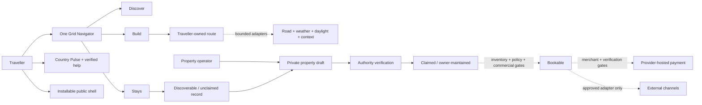
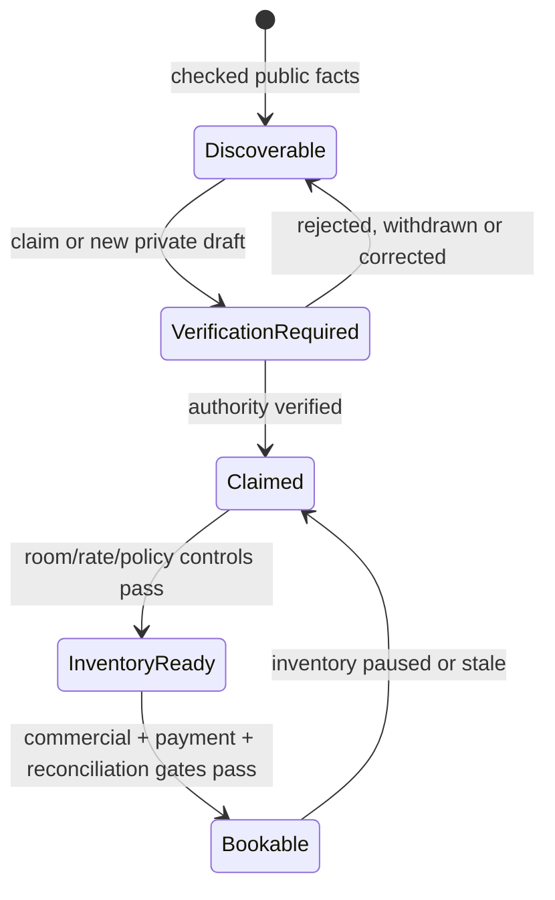

# Public architecture notes

This document explains TPTS Grid at a system-boundary level. It intentionally omits production source, private endpoints, internal schemas, infrastructure identifiers, credentials, customer data and provider secrets.

## Architectural intent

Grid is organised around one principle: **TPTS owns the journey while integrations remain replaceable edges**.

The core must still let a traveller discover Namibia, shape a route and let a legitimate operator claim or add a place when any outside provider is unavailable. External demand, supply, intelligence and payment services may extend that core only through explicit evidence and approval gates; none defines the canonical TPTS record.

## Current public footprint

As of 18 October 2026, the production pilot contains:

- 22 sourced destination anchors;
- one Grid Navigator with Discover, Build and Stays primary lenses over a shared MapLibre map;
- a traveller-owned route with add, remove, reorder, name, duration, local save, deliberate share and static export;
- five subordinate evidence views inside Build that reuse the shared map rather than mounting competing maps;
- openrouteservice road geometry and estimates behind a bounded server adapter;
- MET Norway weather and solar context, NASA POWER climatology, NASA EONET awareness and aggregate-only GBIF context;
- Country Pulse with latest-model context, dated UK FCDO source links and verified Namibian help contacts;
- 28 factual public property records: 17 OSM nodes, 10 OSM geometry centroids and one record that retains no guessed point;
- claim and account-free correction/removal paths for every public stay;
- private owner onboarding into a verification-required state;
- 35 integration records: 1 owned, 8 live, 3 build-ready, 8 apply, 12 evaluate and 3 restricted;
- a guarded OneGate API V2 boundary with live payment creation and automatic paid-state confirmation disabled;
- an installable PWA shell with a strictly bounded offline safety experience;
- 10 licensed photographs and 3 labelled AI-assisted photorealistic campaign compositions kept separate from supply evidence;
- full Desert Day and Astro Night visual themes using Geologica, IBM Plex Sans and IBM Plex Mono.

The product is a production discovery, route-planning and onboarding pilot. It is not yet a live accommodation marketplace.

## System context

## One map, three task lenses

The Grid Navigator is the traveller's only persistent map.

- **Discover** reads the country through destination anchors and local context.
- **Build** puts the chosen route, controls and evidence first.
- **Stays** synchronises factual property points with a text result list.

The route evidence dock inside Build is subordinate to those primary tasks. Route truth, daylight, weather, essentials and living context alter the overlay and evidence panel on the same map. The ordered route and camera context remain stable.

The Atlas Lens is a non-map regional distribution view. The owner precision map mounts only after an explicit request and places or reviews one public-facing property point. Neither is an alternative traveller map.

## Source and truth boundaries

| Domain | Current source posture | Public limitation |
| --- | --- | --- |
| Destination anchors | TPTS-authored geographic planning layer | Context, not inventory, access or safety authority |
| Public stays | Independently checked name, locality, official site and OSM provenance where available | Discoverable does not mean claimed, partnered, rated, available or bookable |
| Road route | openrouteservice response accepted only through a bounded server adapter | Planning estimate, not navigation, traffic, closure, access or safety authority |
| Weather | MET Norway point forecast with provider time and attribution | Forecast model, not a local observation or road-condition report |
| Daylight | MET Norway Sunrise solar events | Astronomical context, not visibility or an arrival-before-dark promise |
| Climate | NASA POWER monthly climatology | Regional historical context, not present weather |
| Natural events | Bounded NASA EONET awareness metadata | Not an official emergency, closure or evacuation feed |
| Biodiversity | Five-year aggregate GBIF occurrence count only | No species, occurrence coordinates, media or sighting prediction |
| Travel advice | Dated GOV.UK Content API links with OGL attribution | General UK FCDO guidance, not personalised visa clearance or Namibian authority advice |
| Emergency contacts | Sourced public Namibian service contacts with coverage notes | TPTS does not auto-dial, triage or guarantee connection/coverage |
| Imagery | 10 licensed photos plus 3 labelled original campaign compositions | Destination atmosphere, never property or inventory evidence |

Each provider can fail or return no match without erasing the traveller's route, map fallback or other sources. Provider state, freshness, attribution and material limitations remain visible near the result.

## Road intelligence failure model

A successful routed response may supply road-following geometry, distance, estimated duration and leg data. If routing is unavailable or invalid:

1. the route remains editable;
2. the interface labels the degraded state;
3. direct-line context may remain visible;
4. road kilometres and drive time are withheld;
5. the degraded result cannot masquerade as successful routed truth.

No result becomes turn-by-turn navigation or a statement about road access, traffic, closures or personal safety.

## Property state machine

The current 28 records are factual discovery records, not current inventory. Owner submissions retain private contact and verification evidence outside the public record. An authenticated owner workspace remains gated behind a future TPTS-owned identity boundary.

## Integration adapter rule

The launchpad's 35 records are programme research and runtime evidence, not a trophy list.

- **Owned** is the TPTS canonical direction.
- **Live** is reserved for a deployed provider-backed capability with attribution, explicit limits and a tested fallback.
- **Build-ready** means a legitimate technical path is documented but activation or governance is incomplete.
- **Apply** means business setup, a commercial plan, sponsorship, affiliate review, NDA/audit or other provider approval is required.
- **Evaluate** means technical access may exist while privacy, licence, safety, cost or inventory-maturity questions remain.
- **Restricted** means the public intake path is paused, enterprise-only or limited to approved partners.

Booking.com Demand and Booking.com Connectivity remain separate programmes. Expedia demand access and lodging connectivity remain separate products. No stage other than `live` claims deployed provider data, and no stage claims a partnership unless an agreement actually exists.

## Guarded payment boundary

The OneGate adapter models a future provider-hosted payment handoff while failing closed today:

1. the server owns total, currency and merchant reference;
2. the current partner credentials are limited to an authorised read-only services check;
3. partner credentials cannot activate merchant payment creation;
4. live creation stays disabled until a distinct merchant-scoped profile and operational/compliance gates exist;
5. sensitive card or banking entry remains on the provider-controlled surface when enabled;
6. the browser cannot declare a booking paid;
7. automatic confirmation remains disabled until a documented provider-originated verification mechanism is replay-safe and reviewed.

Public readiness output never exposes a secret, token, organisation identifier or raw provider response.

## PWA and offline boundary

The production site is installable, but its offline promise is intentionally narrow.

The service worker may cache:

- the manifest and app icons;
- the static offline safety page;
- immutable same-origin public assets and media.

It does not cache:

- API responses;
- owner or authenticated pages;
- listing, booking, checkout or payment responses;
- live weather, live maps or live availability as though they were current.

Navigation failure falls back to the stored safety shell, which shows verified core contacts and states which live services are unavailable. The traveller-generated Offline Route Pack is a static export with its own generation time; it is not the service worker cache and never updates itself.

## Presentation is not data

Desert Day, Astro Night, animation, licensed photography and original campaign compositions form the presentation layer. They cannot mutate route order, provider state, property status, inventory or payment truth.

The three AI-assisted compositions are explicitly labelled and kept out of property cards and factual supply records. The production experience carries visible source/provenance cues; the public [image register](image-provenance.md) records the rights and use boundaries.

## Release evidence

The production release from reviewed private revision `a7bdf8143ec2258dc555820640c2a237f038768f` was verified on 18 October 2026. Type checking, lint, 6/6 automated tests and the production build passed. Browser checks covered wide desktop, laptop, tablet and 390/320 px phone layouts in the tested flows, with no observed horizontal overflow or console errors.

Point-in-time HTTP checks confirmed the canonical root, manifest, service worker and offline safety page were available with security headers. These observations are release evidence—not an uptime, latency, accessibility, provider-coverage, navigation, access or safety guarantee.

Provider secrets remain environment configuration. The public case study is deliberately non-deployable and discloses no credentials, raw payment provider material or operational runbook.
