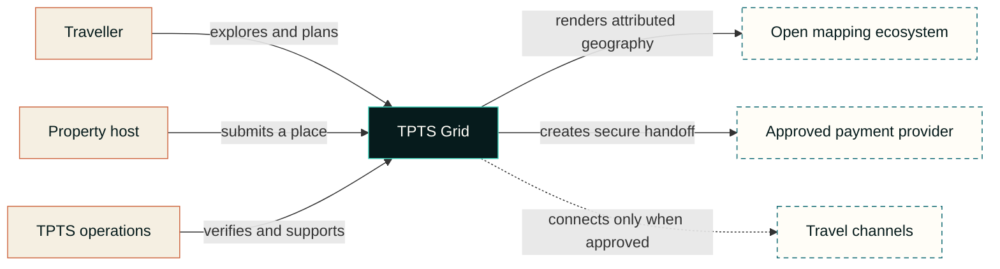
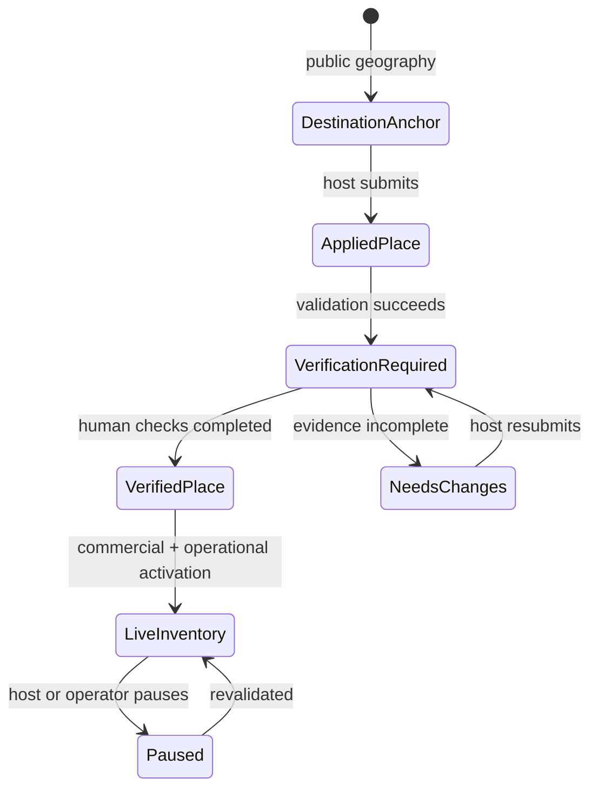

# Public architecture notes

This document explains TPTS Grid at a system-boundary level. It intentionally omits production source, endpoints, schemas, credentials, infrastructure identifiers and private partner specifications.

## Architectural intent

Grid is organised around one principle: **TPTS owns the journey while integrations remain replaceable edges**.

The core product must still help a traveller discover Namibia, shape a route and find verified local supply when a global channel is unavailable. External demand, supply and payment providers extend that system through explicit approval gates; they do not define its internal model.

## System context

## Capability boundaries

### Experience layer

Owns navigation, map interaction, route composition, accessible fallbacks and transparent state labels. It can suggest an itinerary, but it must not fabricate a rate, room, road condition or partnership.

### Geographic intelligence

Stores public destination anchors and TPTS-authored planning metadata separately from commercial properties. Renderer, base-map source, route logic and inventory remain independent so one can change without corrupting the others.

### Supply and verification

Accepts a minimal property application, binds it to the authenticated submitter where applicable, and places it in a review state. Publication, claiming and bookability are separate decisions. This protects both travellers and legitimate property owners.

### Inventory and booking intent

Represents verified TPTS supply and the traveller's intended stay. Prices, availability and policy terms require source provenance and a freshness rule. The browser never gets authority to declare its own total or payment outcome.

### Payment orchestration

Creates the provider handoff from a server-owned booking intent. Sensitive payment entry should remain on a provider-controlled surface. A final payment state requires a verified provider-originated confirmation and replay-safe processing. The exact provider protocol is private and contract-dependent.

### Channel adapters

Translate approved partner programmes into the Grid model without leaking provider-specific assumptions into the traveller experience. Demand access and supply connectivity are different products and must not be described as interchangeable.

## Data classifications

| Class | Examples | Public case-study treatment |
| --- | --- | --- |
| Public geography | Town names, public coordinates, corridor labels | May be documented with source attribution |
| Public product content | Brand language, feature descriptions, non-sensitive status | May be documented accurately |
| Operational | Verification notes, internal moderation state, support history | Private |
| Personal | Host contact details, traveller identity, location permission data | Private; collect minimally |
| Commercial | Rates, availability, agreements, channel identifiers | Private and source-governed |
| Payment-sensitive | Credentials, provider payloads, cardholder data, signatures | Never in this repository; cardholder data should not transit TPTS surfaces |

## Trust transitions

Each transition adds evidence. A public map pin never skips directly to “bookable”.

## Resilience principles

- **Map failure is not product failure.** Keep a text directory and manual coordinate entry available.
- **Channel failure is not inventory loss.** Preserve a canonical TPTS record and explicit source provenance.
- **Browser success is not payment success.** Only trusted server-side confirmation can settle a booking state.
- **Generated advice is not operational truth.** Separate suggestions from live availability, policy and road-safety data.
- **Retry is expected.** Mutating operations require replay-safe design and observable outcomes.
- **Remote bandwidth matters.** Prioritise first interaction, defer secondary map instances and keep media deliberate.

## Deployment posture

The product is intended for an edge-hosted web runtime with a private source repository, managed configuration, encrypted transport, environment-scoped secrets and auditable data migrations. The public case study is deliberately non-deployable. Environment topology, account identifiers and operational runbooks are not disclosed here.

## External programme gates

Partner-facing work follows a consistent sequence:

1. confirm the programme accepts the intended business model and market;
2. complete commercial, privacy, PCI and security review as applicable;
3. receive provider-issued access and current specifications;
4. implement against a sandbox or certification environment;
5. test failure, cancellation, reconciliation and support paths;
6. obtain production approval before surfacing a live status.

See the official paths linked in the [main case study](../README.md#verified-external-pathways). Public documentation is informative; the executed agreement and provider-issued implementation material govern a live integration.
