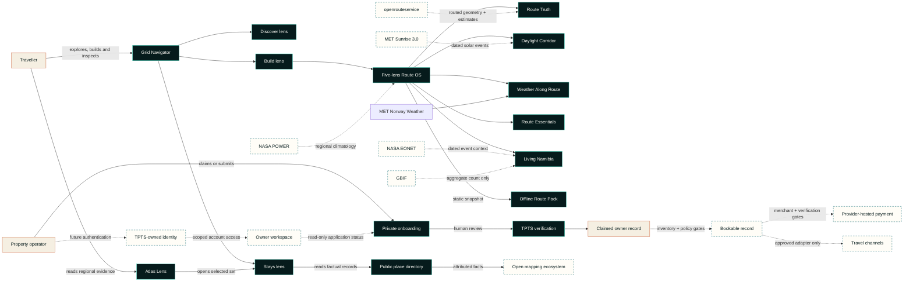
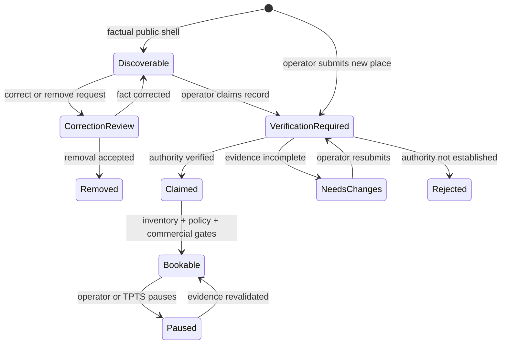

# Public architecture notes

This document explains TPTS Grid at a system-boundary level. It intentionally omits production source, endpoints, schemas, credentials, infrastructure identifiers and private partner specifications.

## Architectural intent

Grid is organised around one principle: **TPTS owns the journey while integrations remain replaceable edges**.

The core product must still help a traveller discover Namibia, shape a route and let a legitimate operator claim or add a place when a global channel is unavailable. External demand, supply and payment providers can extend that system only through explicit approval gates; they do not define its internal model.

## Current public footprint

As of 18 October 2026, the public product contains:

- 21 destination anchors for geographic route context;
- one Grid Navigator with Discover, Build and Stays task lenses over a shared traveller map;
- traveller-controlled route search, add, remove, reorder, duration, local save and deliberate sharing inside Build;
- TPTS Road Intelligence with live MET Norway point forecasts, production-connected openrouteservice routing and a direct-line fallback that withholds road kilometres and drive time;
- a five-lens Route OS inside the same Build map: Route Truth, Daylight Corridor, Weather Along Route, Route Essentials and Living Namibia;
- live MET Norway Sunrise solar context, NASA POWER regional climate memory, bounded NASA EONET awareness and an aggregate count-only GBIF signal;
- a static Offline Route Pack that records generation time, available source context and planning limits without claiming offline map tiles or live navigation;
- three visual map appearances—Field, Atlas and Signal—over the same underlying truth;
- 28 factual property directory records, including 27 exact OSM-sourced points;
- an Atlas Lens that presents regional record distribution without mounting a duplicate directory map;
- a claim path and an account-free correction/removal path for every public record;
- private owner onboarding into a verification queue, with its single-point precision map mounted only on request;
- owner authentication and account visibility held behind a future TPTS-owned identity gate, not claimed as live;
- a 29-path integration launchpad with 1 owned, 7 live, 2 ready, 6 apply, 10 evaluate and 3 restricted records;
- a payment readiness boundary with live creation and paid-state confirmation disabled.

Every current public property record is `unclaimed-directory` with `inventoryStatus: none` and `relationshipStatus: not-a-tpts-partner` in the product source. Those fields are a deliberate public contract, not placeholder marketing copy.

The Route OS deployment was externally verified on 18 October 2026. The five lenses reuse one MapLibre instance and one traveller-owned route; they are not separate maps. Route Essentials remains visibly gated and empty until a governed, versioned Namibia extract exists. openrouteservice is production-connected through the bounded server adapter; the tested fallback still exposes only direct-line context and withholds road kilometres and drive time whenever the provider is unavailable.

## System context

## Capability boundaries

### Experience layer

Owns navigation, map interaction, route composition, accessible fallbacks and transparent state labels. The Grid Navigator keeps three tasks in one traveller map: Discover reads destination context, Build composes an editable trip and Stays inspects factual property signals. A cinematic opening composer may suggest an itinerary, but every stop remains editable. Without a successful routing-provider response, its line is journey order and direct-line context; road kilometres and drive time are withheld. Story cards, directory actions and search controls enter the relevant lens instead of creating more map instances. The experience must not fabricate a rate, room, road condition or partnership.

### Geographic intelligence

Stores public destination anchors and TPTS-authored planning metadata separately from commercial properties. The three Navigator lenses change the traveller's task; the five Route OS lenses inside Build change the intelligence overlay; Field, Atlas and Signal change appearance only. All three layers preserve one map, one ordered route and one selection state.

Renderer, base-map source, route logic, provider-derived road geometry, weather, daylight, climate, natural-event context, biodiversity context, factual property records and future inventory remain independent so one can degrade without corrupting the others. Point weather is attributed to MET Norway. The live Route OS computes a shared solar window from MET Norway Sunrise 3.0, samples regional climatology from NASA POWER, bounds EONET queries to the selected route envelope and reduces GBIF to a five-year aggregate count. The public GBIF output contains no occurrence records, taxa names, coordinates or media. The production-connected openrouteservice boundary can supply road-following geometry, distance and estimated duration after a successful response, but never turn-by-turn navigation, live access or safety authority. Provider failure remains visible and falls back to direct-line context with road metrics withheld.

Route Essentials has a UI boundary but no unverified live objects. Fuel, water, clinic, repair and similar points require a versioned TPTS-hosted Namibia extract, ODbL-aware governance, snapshot-age display and an incomplete-data fallback before the lens can be populated. A public Overpass service is not a production runtime dependency.

The Atlas Lens is a non-map evidence view of regional record distribution, while the host precision map is an isolated, on-demand tool for setting one public point. Neither competes with the traveller map.

### Intelligence truth and freshness

Every intelligence section carries enough metadata for the interface to explain what it knows and what it does not:

| Signal | Required public evidence | Explicit limit |
| --- | --- | --- |
| Route | Provider state and generation time; provider-derived road result only after successful routing | Direct-line context is not road distance; routed geometry is not navigation or a safety verdict |
| Weather | Provider attribution and forecast time | Point forecast, not corridor conditions or proof of access |
| Daylight | Route date, Namibia offset, source and per-stop solar events | Astronomical calculation, not visibility or a departure recommendation |
| Climate Memory | Month, evidence period, sample count, regional resolution and source | Historical climatology, not current or hyperlocal weather |
| Natural events | Lookback window, source and event timestamps | Dated, non-exhaustive awareness—not emergency, closure or evacuation authority |
| Biodiversity | Observation-year range, aggregate count, route envelope and source | Count-only output; no occurrence records, taxa, coordinates or media, and never a sighting prediction |
| Route Essentials | Snapshot version and age once activated | Mapped services can be incomplete, closed or unsuitable; confirm locally |
| Offline Route Pack | Export time, included sources and each available provider state | Static last-known snapshot; it does not refresh itself |

An empty result is rendered as “no matching result returned” or “unavailable,” not as proof that an event, service or species is absent. Provider failure never falls through to invented data.

### Supply and verification

Publishes only a minimal factual shell for an unclaimed public record. A property card can start a claim, while every record offers an account-free correction/removal route. New-property and claim submissions collect a public point plus operating context and private contact data, bind the submission to the owner where applicable, and place it in a review state. The precision map is lazy and explicit: it opens only when an operator chooses to place or review that public point, and exact check-in directions can remain private. No authenticated owner account or workspace is claimed live on the canonical customer production surface. That capability remains gated until TPTS operates its own identity boundary; a future workspace must scope records to the authenticated owner, remain separate from operator review and never expose operator credentials to the browser. Discoverability, claiming and bookability are separate decisions.

### Inventory and booking intent

Represents a future verified TPTS supply ledger and the traveller's intended stay. Prices, availability and policy terms require source provenance and a freshness rule. No live OTA or native inventory is represented in the current directory. The browser never gets authority to declare its own total or payment outcome.

### Payment orchestration

The implemented boundary is prepared to create a provider handoff from a server-owned booking intent, but live creation is disabled. Production verification confirmed payment mode disabled, partner diagnostics configured and distinct merchant credentials absent. The partner diagnostic scope is read-only and cannot be reused as a merchant payment profile. When separately authorised, sensitive payment entry should remain on a provider-controlled surface. A final payment state requires verified provider-originated confirmation and replay-safe processing; browser redirects and callbacks cannot settle it.

### Channel adapters

The launchpad records 29 owned, public-data, intelligence, messaging, demand, supply and distribution paths by readiness stage. Seven public-data paths are live because deployed provider-backed behaviour and fallbacks were verified; the other states do not prove a credential, approval or agreement exists. Future approved adapters must translate into the Grid model without leaking provider-specific assumptions into the traveller experience. Demand access and supply connectivity are different products and must not be described as interchangeable.

## Data classifications

| Class | Examples | Public case-study treatment |
| --- | --- | --- |
| Public geography | Town names, destination coordinates, OSM property points, corridor labels | May be documented with source attribution and a correction path |
| Public product content | Brand language, feature descriptions, non-sensitive status | May be documented accurately |
| Operational | Verification notes, internal moderation state, support history | Private |
| Personal | Host contact details, traveller identity, location permission data | Private; collect minimally |
| Commercial | Rates, availability, agreements, channel identifiers | Private and source-governed |
| Payment-sensitive | Credentials, provider payloads, cardholder data, signatures | Never in this repository; cardholder data should not transit TPTS surfaces |

## Trust transitions

Each transition adds evidence. Discoverable does not mean claimed, and claimed does not mean bookable. A public map pin never skips directly to live inventory.

## Resilience principles

- **Map failure is not product failure.** Keep the Build editor, synchronized text results, factual directory and manual coordinate entry available.
- **Provider failure is not itinerary failure.** Weather, routing, route editing and the base map degrade independently, and unavailable road metrics are withheld rather than guessed.
- **One provider is not the Route OS.** Weather, daylight, climate, natural-event and biodiversity requests settle independently; one timeout cannot erase the route or masquerade as a complete dataset.
- **No match is not proof of absence.** Empty EONET, GBIF or future Route Essentials results keep their evidence window and coverage warning.
- **Offline means last known.** An exported pack carries its generation time and limitations and never presents itself as a live feed.
- **Channel failure is not inventory loss.** Preserve a canonical TPTS record and explicit source provenance.
- **Browser success is not payment success.** Only trusted server-side confirmation can settle a booking state.
- **Generated advice is not operational truth.** Separate suggestions from live availability, policy and road-safety data.
- **Retry is expected.** Mutating operations require replay-safe design and observable outcomes.
- **Remote bandwidth matters.** Prioritise first interaction, defer secondary map instances and keep media deliberate.

## Deployment posture

The canonical customer production surface is [tpts-grid.pages.dev](https://tpts-grid.pages.dev) on Cloudflare Pages. It uses managed configuration, encrypted transport, environment-scoped secrets and auditable data migrations. Its public discovery surface is separate from the private host-intake and operator boundaries. On 18 October 2026, the Route OS release passed surface checks, same-origin MapLibre-worker delivery, a live 696 px browser walkthrough, separate 390 px and 320 px responsive layout checks, maximum-route schema validation, cold/warm cache checks and a Cloudflare runtime-tail check. The earlier openrouteservice activation deployment also proved failure-safe degradation: its initial failed route withheld road metrics and was not written to the normalized TPTS edge cache. Hardened runtime revision `c8000f6` was then reverified on the stable hostname with a fresh 12-stop route returning connected routed truth, 9,719 geometry points, 2,778.5 km, 2,173 minutes and 11 legs, followed by an exact-repeat cache hit. Provider secrets remained environment configuration rather than properties of a deployment URL. The observations are release evidence, not an uptime or latency guarantee. The public case study remains deliberately non-deployable; environment identifiers, credentials and operational runbooks are not disclosed here.

## External programme gates

Partner-facing work follows a consistent sequence:

1. confirm the programme accepts the intended business model and market;
2. complete commercial, privacy, PCI and security review as applicable;
3. receive provider-issued access and current specifications;
4. implement against a sandbox or certification environment;
5. test failure, cancellation, reconciliation and support paths;
6. obtain production approval and complete reconciliation/support runbooks before surfacing a live status.

See the readiness stages in the [main case study](../README.md#safe-integration-launchpad) and the official sources in the [verification register](verification-register.md). Public documentation is informative; the executed agreement and provider-issued implementation material govern a live integration.
